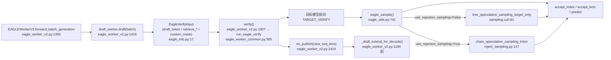
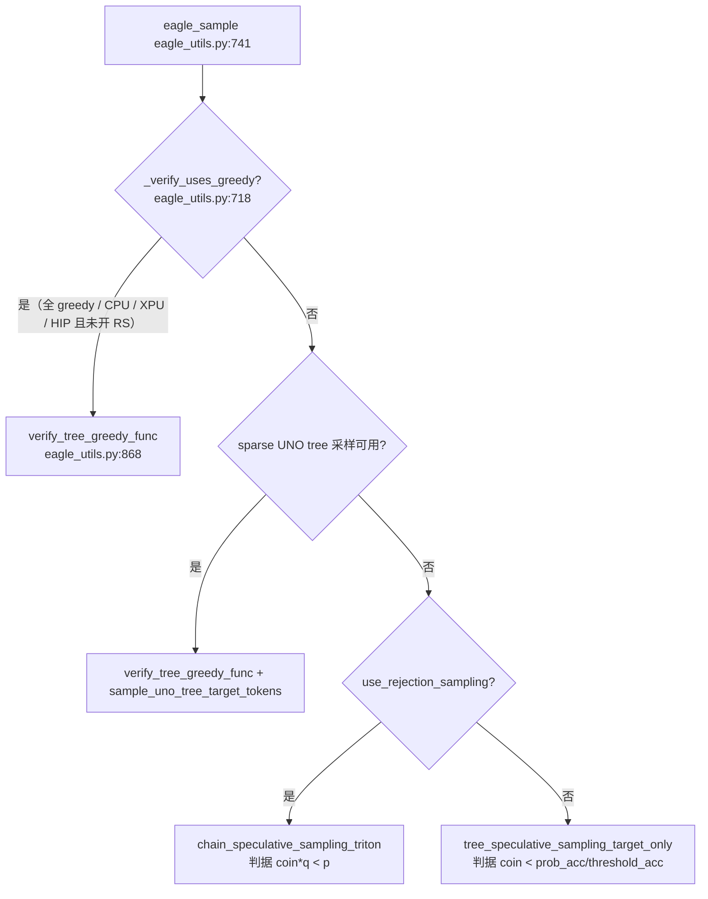

# 子文档：SGLang 投机解码路径与 EAGLE 官方实现对照

> ⚠️ **信息来源声明**：本文由 AI Agent 基于公开开源仓库源码只读精读整理。所有行为结论标注 `文件:行`，区分「代码事实」与「研究推断」。
>
> **调研日期**：2026-10-16
> **主文档**：[report.md](report.md)
> **SGLang 版本**：`sgl-project/sglang` @ `2a08e261ecd4cdfb04ec354f9005f18b88108b7d`（2026-10-16）
> **对照对象**：`SafeAILab/EAGLE` @ `cb7e0841fe0c206c6ed74a197ad5e2a1f13f5a2b`（该侧结论取自本仓库既有专题 `Infra/SpeculativeDecoding/speculative-stochastic-verification.md` §5.1 第 ① 项，本轮**未重新 clone EAGLE**）
> **证据标签**：单一主等级。SGLang 侧一律 **`[精读原文（SGLang 源码 @ 本报告 SHA）]`**；EAGLE 侧一律 **`[精读原文（EAGLE 源码 @ cb7e0841，经既有专题转引）]`**——即对 SGLang 是直接一手核验，对 EAGLE 是转引本仓库已完成的一手核验，不再独立复现。
> **任务来源**：把既有专题 §5.1 第 ① 项的代码结论落到 SGLang 侧的具体调用链。

---

## 1. 先给答案

1. **SGLang 的 EAGLE 验证有两条路径，判据数学上不同，由 `speculative_use_rejection_sampling` 切换。** 默认（`False`）走"目标-only" kernel，草稿被当作 point mass；开启后走 Leviathan 式拒绝采样 kernel，用真实草稿分布。 **[精读原文（SGLang 源码 @ 本报告 SHA）]**
2. **默认路径的拒绝残差会排除已拒候选**：topk=1、阈值均为1时，接受 $p(x)$ 与条件残差混合恢复目标p；不能写成拒绝后直接从p采样。EAGLE本体拒绝分支未在本轮重新读，完整同构待证。 **[精读原文（SGLang 源码 @ 本报告 SHA）]**
3. **topk=1 时草稿 logits 的 top-1 概率在默认路径被显式写成 `1.0`**（`[eagle_worker_v2.py:1207](<https://github.com/sgl-project/sglang/blob/2a08e261ecd4cdfb04ec354f9005f18b88108b7d/python/sglang/srt/speculative/eagle_worker_v2.py>)`），这与 EAGLE 的 `qx = 1.0` 只能作为**确定性草稿接受概率的有条件比较**，完整输出还要核拒绝残差与状态更新——前者写在提议端（`topk_p`），后者写在验证端（`qx`）。 **[精读原文（SGLang 源码 @ 本报告 SHA）+ 研究推断]**
4. **既有专题 §5.1 第 ② 项（SGLang issue #10308 的后续修复状态）在本 commit 上得到实质性进展证据**：`--speculative-use-rejection-sampling` 正是该 issue 请求的"把 draft 预测概率传给验证阶段"，且已有专门的回归测试。但**该 flag 与 #10308 之间没有可核验的 link 关系**，我**不据 PR 编号断言"#10308 已被修复"**。 **[精读原文（SGLang 源码 @ 本报告 SHA）]**

---

## 2. 总览：一次 decode 步里 spec 的三段



图中每个节点都有源码锚点：`eagle_worker_v2.py:1350,1416,1424,1190,1907`、`eagle_worker_common.py:565`、`eagle_utils.py:741`、`sampling.cuh:81`、`reject_sampling.py:147`、`eagle_info.py:17`。 **[精读原文（SGLang 源码 @ 本报告 SHA）]**

---

## 3. 提议端：草稿概率在 SGLang 里怎么产生

### 3.1 topk=1 的默认分支：把 top-1 概率写成 1.0

`EagleDraftWorker._draft_extend_for_decode` 的收尾分派（`[eagle_worker_v2.py:1190](<https://github.com/sgl-project/sglang/blob/2a08e261ecd4cdfb04ec354f9005f18b88108b7d/python/sglang/srt/speculative/eagle_worker_v2.py>)` 起）：

| 分支 | 条件 | `topk_p` | `topk_index` | `draft_probs` |
|---|---|---|---|---|
| A | `speculative_use_rejection_sampling` | `q(X)`（真实采样概率） | 采样得到的 token | `q` 全分布 |
| B | `topk==1 and _is_hip` | argmax-only（不产概率） | argmax | `None` |
| C | `topk==1 and not _is_hip` | **`torch.ones_like(...)`** | argmax | `None` |
| D | `else`（topk>1） | `fast_topk(probs, topk)` | top-k | `None` |

分派位置：`[eagle_worker_v2.py:1190](<https://github.com/sgl-project/sglang/blob/2a08e261ecd4cdfb04ec354f9005f18b88108b7d/python/sglang/srt/speculative/eagle_worker_v2.py>)`。

**代码事实（分支 C）**：`[eagle_worker_v2.py:1201](<https://github.com/sgl-project/sglang/blob/2a08e261ecd4cdfb04ec354f9005f18b88108b7d/python/sglang/srt/speculative/eagle_worker_v2.py>)` 之后的代码是 `ret_topk_index = torch.argmax(...)` 与 `ret_topk_p = torch.ones_like(ret_topk_index, dtype=torch.float32)`——**草稿 top-1 概率被硬写成 1.0**。这正是 EAGLE `eagle/model/utils.py:398` 的 `qx = 1.0` 在提议端的等价表达。 **[精读原文（SGLang 源码 @ 本报告 SHA）]**

**研究推断**：分支 B（HIP，`[eagle_worker_v2.py:1196](<https://github.com/sgl-project/sglang/blob/2a08e261ecd4cdfb04ec354f9005f18b88108b7d/python/sglang/srt/speculative/eagle_worker_v2.py>)`）连概率都不产出，说明在"草稿按 point mass 处理"的前提下，`topk_p` 的具体数值对最终接受判定**无影响**；HIP 分支的存在从侧面印证了这一点。若将来有人把 `topk_p` 接进某个新判据，HIP 与 CUDA 会分叉——这是我对维护成本的一个担忧，代码里没有任何机制阻止它发生。

### 3.2 严格分支：`sample_draft_proposal` 产出真实分布

`[spec_utils.py:166](<https://github.com/sgl-project/sglang/blob/2a08e261ecd4cdfb04ec354f9005f18b88108b7d/python/sglang/srt/speculative/spec_utils.py>)` 的 docstring 把正确性条件写得很明确（原文要点）：返回 `(q, q(X), X)`，且 "The verify's accept test `coin*q(X) < p(X)` is unbiased only if q is exactly the distribution X was drawn from, so callers must hand the returned q (not a recomputed one) to the verify."

同一 docstring 还处理了一个**容易出错的行**：当某行 `top_k == 1`（greedy）时，提议改成 argmax 而非从 q 采样，此时 `X` 不再来自 `q`——它靠 `eagle_sample` 侧"用同一份 per-row `top_k` 重新归一化目标分布"来保持正确。 **[精读原文（SGLang 源码 @ 本报告 SHA）]**

**代码事实**：`sample_draft_proposal` 内部对 `top_ks` 做 `assert top_ks.device == probs.device`，注释解释了原因——宿主侧 top_ks 会让这个修正"静默消失"，症状是草稿接受长度悄悄掉约 20%，"reads as a model problem, not a plumbing one"（`[spec_utils.py:193](<https://github.com/sgl-project/sglang/blob/2a08e261ecd4cdfb04ec354f9005f18b88108b7d/python/sglang/srt/speculative/spec_utils.py>)`）。 **[精读原文（SGLang 源码 @ 本报告 SHA）]**

---

## 4. 验证端：三个不同的接受判据

`eagle_sample()`（`[eagle_utils.py:741](<https://github.com/sgl-project/sglang/blob/2a08e261ecd4cdfb04ec354f9005f18b88108b7d/python/sglang/srt/speculative/eagle_utils.py>)`，docstring 在 752 行）内部按情况分派到**三个**不同判据：



### 4.1 判据 A：greedy（argmax 一致即接受）

`verify_tree_greedy_func`（`[eagle_utils.py:868](<https://github.com/sgl-project/sglang/blob/2a08e261ecd4cdfb04ec354f9005f18b88108b7d/python/sglang/srt/speculative/eagle_utils.py>)`）用 `target_predict = argmax(next_token_logits)` 与候选 token 逐位比对。 **[精读原文（SGLang 源码 @ 本报告 SHA）]**

### 4.2 判据 B：默认目标-only（无 $p/q$）

`eagle_sample` 在非 rejection 路径构造：

```python
draft_probs = (
    verify_input.draft_probs
    if use_rejection_sampling
    else torch.zeros_like(target_probs)
)
```

`[eagle_utils.py:1000–1003](<https://github.com/sgl-project/sglang/blob/2a08e261ecd4cdfb04ec354f9005f18b88108b7d/python/sglang/srt/speculative/eagle_utils.py>)`（**行号更正**：`draft_probs = (` 起于第 **1000** 行，其中 `torch.zeros_like(target_probs)` 在第 **1003** 行；第 999 行是紧邻其前的 `target_probs = target_probs.reshape(bs, verify_input.draft_token_num, -1)`，不是本判据的锚点）。 **[精读原文（SGLang 源码 @ 本报告 SHA）]**

**代码事实**：`else` 分支把 `draft_probs` 置为**与 target_probs 同形状的全零张量**，随后传给 CUDA kernel `tree_speculative_sampling_target_only`（`[sampling.py:33](<https://github.com/sgl-project/sglang/blob/2a08e261ecd4cdfb04ec354f9005f18b88108b7d/python/sglang/kernels/ops/speculative/sampling.py>)`）。 **[精读原文（SGLang 源码 @ 本报告 SHA）]**

kernel 内部（`[sampling.cuh:72](<https://github.com/sgl-project/sglang/blob/2a08e261ecd4cdfb04ec354f9005f18b88108b7d/python/sglang/kernels/jit/include/sgl_kernel/speculative/sampling.cuh>)` 起）：

- 接受判据：`has_target_mass && (coin < prob_acc / threshold_acc || target_prob_single >= threshold_single)`（`[sampling.cuh:81](<https://github.com/sgl-project/sglang/blob/2a08e261ecd4cdfb04ec354f9005f18b88108b7d/python/sglang/kernels/jit/include/sgl_kernel/speculative/sampling.cuh>)`），其中 `prob_acc` 是该节点起**同层兄弟节点目标概率的累加和**。
- **关键注释**：`// FIXME: leverage draft probs`（`[sampling.cuh:92](<https://github.com/sgl-project/sglang/blob/2a08e261ecd4cdfb04ec354f9005f18b88108b7d/python/sglang/kernels/jit/include/sgl_kernel/speculative/sampling.cuh>)`），该行内容是把被拒候选的目标概率**写回** `draft_probs`。
- 残差采样：从 `relu(target_probs - draft_probs)` 上按 CDF 采样（`[sampling.cuh:104](<https://github.com/sgl-project/sglang/blob/2a08e261ecd4cdfb04ec354f9005f18b88108b7d/python/sglang/kernels/jit/include/sgl_kernel/speculative/sampling.cuh>)`、`[sampling.cuh:120](<https://github.com/sgl-project/sglang/blob/2a08e261ecd4cdfb04ec354f9005f18b88108b7d/python/sglang/kernels/jit/include/sgl_kernel/speculative/sampling.cuh>)`）。

**数学解释（限定 topk=1，`threshold_acc=threshold_single=1`）**：此时只有一个确定性候选 $x$，接受条件为 $u<p(x)$。被拒时 `sampling.cuh:93` 将 $p(x)$ 写入工作缓冲 `draft_probs[x]`，`:104-123` 从 `relu(target_probs-draft_probs)` 求和采样，所以残差在 $x$ 处为零，其他位置为 $p(y)$ 的权重；归一化后是 $p(y)/(1-p(x))$，**不是 $p$ 本身**。接受和拒绝两支混合后才得到目标 $p$。该缓冲的全零初始化不表示“真实提议分布 $q=0$”，而是目标-only 算法用于记录已拒候选的工作空间。阈值修改、topk>1、多步树状态以及 EAGLE 另一实现都需要分别核验，不能由这条单步推导代替。

### 4.3 判据 C：严格拒绝采样（`coin * q < p`）

`use_rejection_sampling=True` 时分派到 `chain_speculative_sampling_triton`（`[reject_sampling.py:242](<https://github.com/sgl-project/sglang/blob/2a08e261ecd4cdfb04ec354f9005f18b88108b7d/python/sglang/kernels/ops/speculative/reject_sampling.py>)`），其 token 式验证主循环为：

```
p = TargetProbs[row, draft_token]
q = DraftProbs[row, draft_token]
q_is_prob = (q > 0.0) & (q <= 1.0)
if q_is_prob & (coin * q < p):   # 接受
```

`[reject_sampling.py:147](<https://github.com/sgl-project/sglang/blob/2a08e261ecd4cdfb04ec354f9005f18b88108b7d/python/sglang/kernels/ops/speculative/reject_sampling.py>)`。 **[精读原文（SGLang 源码 @ 本报告 SHA）]**

残差与最终采样：`diff = residual_scale * p_val - q_val`，取正部做 CDF（`[reject_sampling.py:188](<https://github.com/sgl-project/sglang/blob/2a08e261ecd4cdfb04ec354f9005f18b88108b7d/python/sglang/kernels/ops/speculative/reject_sampling.py>)`）；每条链只验证到**第一个被拒**位置（token-wise），另有 `block_verification=True` 时走 Algorithm 2 的前缀级判据（`[reject_sampling.py:51](<https://github.com/sgl-project/sglang/blob/2a08e261ecd4cdfb04ec354f9005f18b88108b7d/python/sglang/kernels/ops/speculative/reject_sampling.py>)` 起的 `tl.static_range` 前缀概率递推）。 **[精读原文（SGLang 源码 @ 本报告 SHA）]**

### 4.4 三条判据并存意味着什么

**研究推断**：同一个 `eagle_sample` 入口（`[eagle_utils.py:741](<https://github.com/sgl-project/sglang/blob/2a08e261ecd4cdfb04ec354f9005f18b88108b7d/python/sglang/srt/speculative/eagle_utils.py>)`）、同一份 `EagleVerifyInput`（`[eagle_info.py:17](<https://github.com/sgl-project/sglang/blob/2a08e261ecd4cdfb04ec354f9005f18b88108b7d/python/sglang/srt/speculative/eagle_info.py>)`），在接受判定上却有三种数学语义。对维护者的影响是：**任何"投机解码无损性"的论断都必须先声明走的是哪条判据**。既有专题 §4 的无损性边界表需要在 SGLang 侧再加一维：`speculative_use_rejection_sampling` 的取值。

---

## 5. 与 `SafeAILab/EAGLE` @ `cb7e0841…` 的逐项对照

### 5.1 并排比较

| 维度 | EAGLE `cb7e0841…`（转引既有专题 §5.1 ①） | SGLang `2a08e261…`（本报告一手核验） |
|---|---|---|
| 接受判据 | `eagle/model/utils.py:399` 的 `acp = px / qx`，其中 `:398` 为 `qx = 1.0` | 默认：`sampling.cuh:81` 的 `coin < prob_acc/threshold_acc`；严格：`reject_sampling.py:147` 的 `coin * q < p` |
| 草稿分布的角色 | 验证期恒定 `qx = 1.0`（树/EA 评估路径） | 提议期 `topk_p = torch.ones_like(...)`（`eagle_worker_v2.py:1207`）；验证期 `draft_probs = zeros_like(target_probs)`（`eagle_utils.py:1000–1003`） |
| 是否存在保留真实 q 的第二实现 | 有：`eagle/modeling_eagle.py:1427` 用 `qx = cart_candidates_prob[batch, j, i]` | 有：`speculative_use_rejection_sampling=True` 时 `eagle_worker_v2.py:1191` 的 `sample_draft_proposal` + `reject_sampling.py:147` |
| 默认状态 | 该路径即官方 tree/EA 评估路径（默认） | `speculative_use_rejection_sampling` 默认 `False`（`speculative_hook.py:117` 的字段定义） |
| 副作用文案 | 未在既有核验中记录 | 仓库文档明确写出代价：`docs/docs/advanced_features/speculative_decoding.mdx:645` 原文含 "a deterministic draft is paid `p(argmax)` per slot because verify is handed a point mass" |
| T>0 下的推论 | 接受率由 $p(x)$ 而非 $\min(1,p(x)/q(x))$ 决定 | 同（默认路径）；开启严格模式后使用实际随机提议分布的 $\min(1,p/q)$ |

### 5.2 结论：两侧行为是否一致

**已核实的是 SGLang 的单步目标-only 机制**：在 topk=1、两阈值均为 1 的条件下，接受 $x$ 的概率为 $p(x)$，拒绝后从排除 $x$ 的条件残差采样。`sampling.cuh:81,93,104-123` 支持这一结论。EAGLE 本体在本轮未重新取源；既有专题的 `qx=1` 只说明接受比值，**不足以证明其拒绝残差及整条输出行为与本实现一致**，因此跨仓库完整同构暂不作为结论。

**需要分别跟踪的四处实现边界**：

1. **默认开关的表达位置不同**。EAGLE 把 `qx = 1.0` 写在**验证端**的 `evaluate_posterior` 里；SGLang 主要写在**提议端**（`topk_p = 1.0`），验证端再用 `draft_probs = zeros` 把这个语义补全。结果是 SGLang 的"草稿是 one-hot"这件事**分散在两个文件的两处赋值**上，改一处不改另一处会产生不一致——这是我在 `report.md §1.4` 标为风险的直接原因。
2. **SGLang 多了一道严格模式的替代路径**，EAGLE 的第二实现（`modeling_eagle.py`）是另一套 HF 风格代码，而 SGLang 是同一个 worker 内由 flag 分派。
3. **SGLang 加了四道工程闸门**（`[speculative_hook.py:1134](<https://github.com/sgl-project/sglang/blob/2a08e261ecd4cdfb04ec354f9005f18b88108b7d/python/sglang/srt/arg_groups/speculative_hook.py>)` 起）：严格模式要求 `speculative_eagle_topk == 1`、`accept_threshold_* == 1.0`、`enable_deterministic_inference == False`，且算法必须是 EAGLE/EAGLE3/NEXTN，否则**启动即报错**。
4. **SGLang 显式排除了降维（hot）草稿词表场景**：启动校验里有硬闸门，`[eagle_worker_v2.py:249](<https://github.com/sgl-project/sglang/blob/2a08e261ecd4cdfb04ec354f9005f18b88108b7d/python/sglang/srt/speculative/eagle_worker_v2.py>)` 在 `draft_vocab_size != target_vocab_size` 时直接 `raise ValueError`；其上的注释（`[eagle_worker_v2.py:247](<https://github.com/sgl-project/sglang/blob/2a08e261ecd4cdfb04ec354f9005f18b88108b7d/python/sglang/srt/speculative/eagle_worker_v2.py>)`）写明原因："FIXME: support reduced (hot) draft vocab by scattering draft probs into the target vocab via the d2t map before the sampling kernel"。降维草稿的 `hot_token_id` 来自草稿模型自带映射（`[eagle_worker_v2.py:347](<https://github.com/sgl-project/sglang/blob/2a08e261ecd4cdfb04ec354f9005f18b88108b7d/python/sglang/srt/speculative/eagle_worker_v2.py>)`）。HIP 自动开启逻辑也据此条件跳过（`[speculative_hook.py:56](<https://github.com/sgl-project/sglang/blob/2a08e261ecd4cdfb04ec354f9005f18b88108b7d/python/sglang/srt/arg_groups/speculative_hook.py>)` 的 `token_map is None`）。

**含义**：凡是草稿词表与目标词表不一致的 EAGLE3 部署（即使用 `--speculative-token-map` 或草稿 checkpoint 自带降维映射的配置），**都不满足开启严格模式的前提**——`[eagle_worker_v2.py:249](<https://github.com/sgl-project/sglang/blob/2a08e261ecd4cdfb04ec354f9005f18b88108b7d/python/sglang/srt/speculative/eagle_worker_v2.py>)` 会直接拒绝启动。也就是说，"topk=1 时把 draft 概率传给验证"这条能力，对降维词表的 EAGLE3 部署**目前不适用**。 **[精读原文（SGLang 源码 @ 本报告 SHA）]**（本报告未核验具体 checkpoint 的词表大小，只主张这条代码闸门的存在。）

### 5.3 对既有专题 §5.1 第 ② 项的更新建议

既有专题写的是"SGLang issue #10308 的后续 PR 与合入状态未确证"。本轮只读核验能补充的**事实**是：

- 主干存在名为 `--speculative-use-rejection-sampling` 的路径，功能上=issue #10308 请求的"把 draft 预测概率传给验证阶段"（`eagle_worker_v2.py:1191` → `eagle_info.py:35` 的 `draft_probs` 字段 → `eagle_utils.py:1000–1003` → `reject_sampling.py:147`）。 **[精读原文（SGLang 源码 @ 本报告 SHA）]**
- 该路径有专门回归测试 `test/registered/spec/eagle/test_eagle_reject_sampling.py`，以 `--speculative-use-rejection-sampling` 启动服务并断言 `avg_spec_accept_length > 2.5`（`[test_eagle_reject_sampling.py:66](<https://github.com/sgl-project/sglang/blob/2a08e261ecd4cdfb04ec354f9005f18b88108b7d/test/registered/spec/eagle/test_eagle_reject_sampling.py>)`）。 **[精读原文（SGLang 源码 @ 本报告 SHA）]**
- 其引入可追溯到提交 `f42ec350b431d0305d34d6c70ea45fdfcd29dcad`（`[mtp] add rejection sampling for speculative decoding (#26312)`，2026-06-20）。 **[精读原文（SGLang 源码 @ 本报告 SHA）]**

**本轮不做的事**：我**没有**在 commit message 或代码里找到 `#10308` 的引用（`git log --grep=10308` 为空），因此**不主张"#10308 已被该 PR 修复"**。两者是"功能对应"而非"link 对应"。 **[精读原文（SGLang 源码 @ 本报告 SHA）]**

**建议既有专题 §5.1 ② 的措辞改为**：SGLang 主干在 2026-06 之后提供了 opt-in 的 draft 概率传递路径（默认关闭、且对 EAGLE3 降维词表不适用），但 issue #10308 本身仍无 linked PR，**"EAGLE 树验证默认丢弃 draft 概率"这一默认行为在主干上依然成立**。

---

## 6. 关键数据结构

| 结构 | 位置 | 作用 |
|---|---|---|
| `EagleDraftInput` | `[eagle_info.py:35](<https://github.com/sgl-project/sglang/blob/2a08e261ecd4cdfb04ec354f9005f18b88108b7d/python/sglang/srt/speculative/eagle_info.py>)` | 草稿侧状态：`topk_p`、`topk_index`、`hidden_states`、`draft_probs`、`future_indices` |
| `EagleVerifyInput` | `[eagle_info.py:17](<https://github.com/sgl-project/sglang/blob/2a08e261ecd4cdfb04ec354f9005f18b88108b7d/python/sglang/srt/speculative/eagle_info.py>)` | 验证侧状态：`draft_token`、`retrieve_index/next_token/next_sibling`、`custom_mask`、`tree_topk` |
| `draft_probs` 字段 | `[eagle_info.py:35](<https://github.com/sgl-project/sglang/blob/2a08e261ecd4cdfb04ec354f9005f18b88108b7d/python/sglang/srt/speculative/eagle_info.py>)`（草稿）/ `:162`（验证） | 形状 `(bs, num_steps, vocab)`；**仅 rejection sampling 下非空** |
| `tree_topk` 属性 | `[eagle_info.py:59](<https://github.com/sgl-project/sglang/blob/2a08e261ecd4cdfb04ec354f9005f18b88108b7d/python/sglang/srt/speculative/eagle_info.py>)` | 传给 tree kernel 的分支因子；`-1` 表示不规则树 |
| `max_tree_depth` | `[eagle_info.py:50](<https://github.com/sgl-project/sglang/blob/2a08e261ecd4cdfb04ec354f9005f18b88108b7d/python/sglang/srt/speculative/eagle_info.py>)` | `spec_steps + 1`，界定 `accept_index` 行宽 |

**代码事实**：`draft_probs` 在 `pad_batch`（`eagle_info.py:200`）、`filter_batch`（`:241`）、`merge_batch`（`:281,304`）三处都有显式处理——任何一处漏改都会让验证 kernel 拿到形状不符的输入，而 `eagle_utils.py:1009` 起有显式 shape 校验把失败提前。 **[精读原文（SGLang 源码 @ 本报告 SHA）]**

---

## 7. 工程闸门清单（启动期校验）

全部集中在 `python/sglang/srt/arg_groups/speculative_hook.py`（`[speculative_hook.py:1134](<https://github.com/sgl-project/sglang/blob/2a08e261ecd4cdfb04ec354f9005f18b88108b7d/python/sglang/srt/arg_groups/speculative_hook.py>)` 起）：

| 闸门 | 行为 | 行 |
|---|---|---|
| 算法白名单 | 非 EAGLE/EAGLE3/NEXTN → `NotImplementedError` | `speculative_hook.py:1134` |
| topk 必须为 1 | `speculative_eagle_topk != 1` → `ValueError` | `speculative_hook.py:1143` |
| 阈值必须为 1.0 | 与 `accept_threshold_*` 不兼容 → `ValueError` | `speculative_hook.py:1147` |
| 与确定性推理不兼容 | "the sampling kernel draws coins from the global RNG and is not batch-invariant" → `ValueError` | `speculative_hook.py:1157` |
| 多层 EAGLE 也必须 topk=1 | 线性链限定 | `speculative_hook.py:1164` |
| `speculative_eagle_topk == 1` 时 draft tokens 自动改写成 `num_steps + 1` | 自动改默认值 + 日志 | `speculative_hook.py:1178` |
| HIP 自动开启严格模式 | 仅在无 token map、topk=1、阈值 1.0、非确定性推理、非 simulate 场景 | `speculative_hook.py:27` |

**代码事实**：这些校验都通过 `declare_resolution` 记录"谁改了默认值"，启动日志会打印 `"Rejection sampling is enabled for speculative decoding (speculative_use_rejection_sampling=True)."`（`speculative_hook.py:1173`）。 **[精读原文（SGLang 源码 @ 本报告 SHA）]**

---

## 8. 维护者建议

1. **改接受判据前先确定语义归属**：`eagle_sample` 的三个分支对应三套数学，`eagle_utils.py:741` 的 docstring 只能覆盖其中一条。
2. **不要把 `topk_p = 1.0`（`eagle_worker_v2.py:1207`）与 `draft_probs = zeros`（`eagle_utils.py:1000–1003`）分开改**——它们是同一语义的两半。
3. **想给 EAGLE3 降维词表开严格模式**，先解决 `eagle_worker_v2.py:27` 附近注释提到的 d2t map scatter 问题；在解决之前，`speculative_hook.py:27` 会主动跳过。
4. **验证 `--speculative-use-rejection-sampling` 与 `--enable-deterministic-inference` 的互斥**是刻意的（coin 来自全局 RNG），不要当成 bug 去"修"。

---

## 9. 引用与核验边界

| 项 | 状态 |
|---|---|
| SGLang @ `2a08e261…` 源码精读 | ✅ 本轮直接核验（clone 到 `/tmp/sglang-clone`，只读，未构建、未修改，读完删除） |
| SGLang issue #10308 是否被修复 | ⚠️ **未确证**。未找到 issue 与代码的 link；只主张"功能对应路径存在" |
| EAGLE @ `cb7e0841…` | ⚠️ **转引**既有专题 §5.1 ① 的一手核验结论，本轮未重新 clone |
| EAGLE `cb7e0841` 是否仍是最新 | ❌ 未核验（本轮未访问 EAGLE 远端） |
| SGLang 运行/性能 | ❌ 完全未涉及；本报告无任何加速比、接受率数字来自 SGLang |
| topk>1 下两侧判据是否等价 | ❌ 未确证；本报告只对 topk=1 线性链下了同构结论 |

> *数据截至 2026-10-16。*
