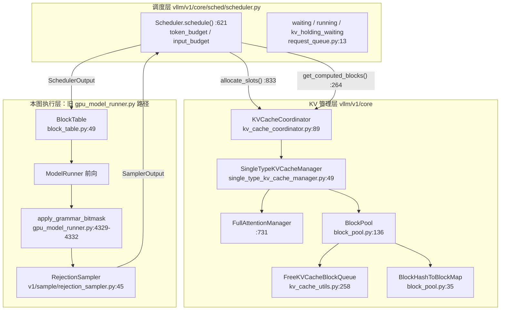
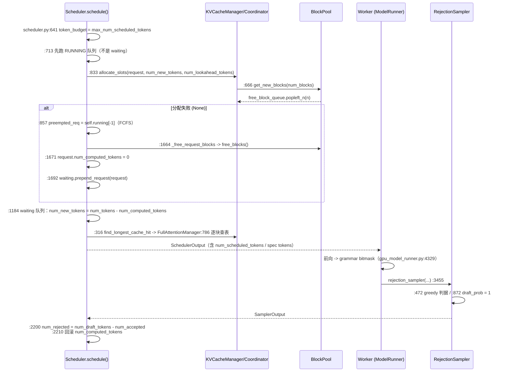

# vLLM 仓库代码分析报告

> ⚠️ **信息来源声明**：本报告由 AI Agent 基于公开开源仓库源码整理生成，方法为**只读精读**（clone 到仓库外临时目录 `/tmp`，部分克隆 `--filter=blob:none`，不构建、不修改、读完删除）。所有行为结论均标注 `文件:行`，并区分「代码事实」与「研究推断」。吞吐/接受率等性能数字**不在本报告结论范围内**——本报告只做代码事实核验，不做性能复现，也**不做跨仓库排行榜**。
>
> **调研日期**：2026-10-16
> **分析对象**：`vllm-project/vllm` @ `fa75d3456d60a5ffe923818c4b495295675b38e1`（2026-10-16 14:17:51 +0800，提交标题 `[Feature][PCP] Add DeepSeek-V4.1-Flash support (#59857)`）
> **模式**：`deep`（code-researcher skill）
> **子文档**：KV 缓存与前缀复用见 [kv-cache-and-prefix-reuse.md](kv-cache-and-prefix-reuse.md)；调度与投机解码见 [scheduling-and-spec-decode.md](scheduling-and-spec-decode.md)；结论审计见 [claim-audit.md](claim-audit.md)
> **姊妹条目（互引）**：[SGLang 仓库代码分析报告](../sglang/report.md) —— 前缀缓存机制对照见 [scheduler-and-prefix-cache.md](../sglang/scheduler-and-prefix-cache.md)，投机解码路径对照见 [speculative-decoding-path.md](../sglang/speculative-decoding-path.md)
> **证据标签**：单一主等级（精读原文 / 摘要级 / 二手 / 受限核验），混合取最弱。本报告主要使用 **`[精读原文（vLLM 源码 @ 本报告 SHA）]`**——指逐行阅读了该 commit 的源码；少量仓库内文档引用标 **`[精读原文（vLLM 仓库文档 @ 本报告 SHA）]`**；跨仓库对照中标 **`[精读原文（SGLang 源码 @ 2a08e261）]`**（转引本仓库既有 SGLang 条目，本轮未重新 clone SGLang）。

---

## 1. 执行摘要

### 1.1 这个项目是什么

vLLM 是一个面向 LLM 的高吞吐推理与服务框架。本报告只覆盖它的**推理引擎内核纵切面**：`vllm/v1/` 下的 **块池（block pool）→ 调度器（scheduler）→ 投机解码验证（rejection sampling）** 链路，外加它与语法约束（structured output）的交互。[精读原文（vLLM 源码 @ 本报告 SHA）]

代码规模（`scan_repo.py` 扫描本 commit 工作树）：Python 1,902,738 行、Rust 140,024 行、Markdown 52,509 行、C++ 51,651 行、Shell 23,684 行。`git ls-files` 层面这是一个**多语言单体仓库**：Python 引擎（`vllm/`）+ C++/CUDA 内核（`csrc/`）+ Rust 侧工具链（`rust/`，含独立 workspace 的 `server` / `engine-core-client` / `bench` 等 crate）。注意：本 commit 里 **KV 缓存与调度逻辑全部在 Python 侧**（`vllm/v1/core/`），本报告只快速了解Rust服务/客户端/基准工具，**没有充分证据排除Rust参与其他部署的数据路径**。[精读原文（vLLM 源码 @ 本报告 SHA）]

### 1.2 中心架构思路

用一句话概括本报告读到的三段设计：

1. **PagedAttention 在 V1 里被拆成"先查哈希、后拿物理块"两步，且块表是 append-only 的**。前缀复用不再靠树，而是靠**逐块链式哈希 + 精确查表**：`[kv_cache_utils.py:1003](<https://github.com/vllm-project/vllm/blob/fa75d3456d60a5ffe923818c4b495295675b38e1/vllm/v1/core/kv_cache_utils.py>)` 的 `hash_block_tokens(caching_hash_fn, prev_block_hash_value, block_tokens, extra_keys)` 把**父块哈希**作为输入，于是"命中第 i 块"蕴含"前 i 块全部相同"；`[single_type_kv_cache_manager.py:786](<https://github.com/vllm-project/vllm/blob/fa75d3456d60a5ffe923818c4b495295675b38e1/vllm/v1/core/single_type_kv_cache_manager.py>)` 从块 0 起逐块 `get_cached_block`，**第一个 miss 即 break**。**[精读原文]**
2. **调度器没有 prefill/decode 两相**。`[scheduler.py:623-632](<https://github.com/vllm-project/vllm/blob/fa75d3456d60a5ffe923818c4b495295675b38e1/vllm/v1/core/sched/scheduler.py>)`（NOTE 注释段；实体代码自 `:634` 起）的注释原文写明 "There's no 'decoding phase' nor 'prefill phase' in the scheduler"，每一步只回答"哪些请求的 `num_computed_tokens` 能向 `num_tokens_with_spec` 追多少"；chunked prefill、prefix caching、投机解码都只是这个统一口径的特例。抢占则是**重新准入并重算未命中部分**：`[scheduler.py:1671](<https://github.com/vllm-project/vllm/blob/fa75d3456d60a5ffe923818c4b495295675b38e1/vllm/v1/core/sched/scheduler.py>)` 把 `request.num_computed_tokens = 0` 并 `prepend_request` 回 waiting 队列，V1 没有 swap-out 路径。**[精读原文]**
3. **投机解码的默认草稿是 one-hot，"真实草稿概率"是需要显式打开的旁路，不能仅据 one-hot 判定随机输出有偏**。`[speculative.py:604](<https://github.com/vllm-project/vllm/blob/fa75d3456d60a5ffe923818c4b495295675b38e1/vllm/config/speculative.py>)` 的 `draft_sample_method: DraftSampleMethod = "greedy"` 文档原文即 "the draft probabilities are treated as one-hot during rejection sampling"；kernel 侧面在 `[rejection_sampler.py:872](<https://github.com/vllm-project/vllm/blob/fa75d3456d60a5ffe923818c4b495295675b38e1/vllm/v1/sample/rejection_sampler.py>)` 以 `draft_prob = 1` 落地。**[精读原文]**

### 1.3 最重要的三个判断

| # | 判断 | 类型 |
|---|---|---|
| 1 | **vLLM 的前缀复用使用链式哈希**；默认按物理块匹配，`--prefix-match-unit` 调小时可按较细哈希边界命中；`[single_type_kv_cache_manager.py:786-792](<https://github.com/vllm-project/vllm/blob/fa75d3456d60a5ffe923818c4b495295675b38e1/vllm/v1/core/single_type_kv_cache_manager.py>)` 的 phase-1 查满块，`:796-815` 的 phase-2 补查块内哈希边界。与 SGLang 的 radix 树路径对照见 §7.1。 | 代码事实 |
| 2 | **抢占归零不等于必然从零计算**。`scheduler.py:1664-1692` 释放请求引用并重入 waiting；再次准入通过 `scheduler.py:1014-1022,588-596` 的 `get_computed_blocks` 查尚存哈希。释放引用与淘汰哈希是不同操作（`block_pool.py:776-804` / `:729-741`），因此命中多少取决于中间的复用、淘汰和配置。 | 代码事实；性能未测 |
| 3 | **grammar 掩码之后的 softmax 已重新归一化**，不能据此断言验证有偏。旧 runner 的真实路径是 `gpu_model_runner.py:4329-4335` → `_sample` → `:3455` → `vllm/v1/sample/rejection_sampler.py:487`；新 runner 在 `worker/gpu/model_runner.py:1662` 进入另一套验证器，不能把两套路径拼成一条。 | 代码事实 + 数学解释 |

### 1.4 最值得关注的风险

- **需要同时核对草稿生成与拒绝后的残差**。`speculative.py:604-609` 说明 greedy 草稿实际是确定性 argmax；旧验证器在 `rejection_sampler.py:1044-1049` 排除被拒候选后采样。one-hot 是该提议分布的正确表示，不能把“没有完整草稿概率张量”直接写成“不是无偏拒绝采样”。随机草稿若未保留实际生成分布才需要另证。
- **同一份"草稿概率"语义在仓库里有两套并行实现**：旧路径把完整 `draft_probs` 张量搬进 kernel（`[rejection_sampler.py:106](<https://github.com/vllm-project/vllm/blob/fa75d3456d60a5ffe923818c4b495295675b38e1/vllm/v1/sample/rejection_sampler.py>)` 的 `draft_probs: torch.Tensor | None`），新路径搬的是 `draft_logits`（`[rejection_sampler_utils.py:1024](<https://github.com/vllm-project/vllm/blob/fa75d3456d60a5ffe923818c4b495295675b38e1/vllm/v1/worker/gpu/spec_decode/rejection_sampler_utils.py>)` 的 `[max_num_reqs, num_speculative_steps, V]`）。两者共享 `draft_sample_method` 这一个开关。 **[精读原文]**
- **语法约束下的草稿必须"因果合法"，这是一个比"掩码"更强的要求**。`[structured_output/utils.py:48](<https://github.com/vllm-project/vllm/blob/fa75d3456d60a5ffe923818c4b495295675b38e1/vllm/v1/structured_output/utils.py>)` 的 `strip_speculative_padding` 只按 `-1` 哨兵截断；真正的合法性检查在 `[structured_output/__init__.py:346](<https://github.com/vllm-project/vllm/blob/fa75d3456d60a5ffe923818c4b495295675b38e1/vllm/v1/structured_output/__init__.py>)` 的 `validate_tokens`，不合格的草稿**被打回 GPU worker 之前就被删掉**。也就是说：**"给草稿也加语法掩码"这件事在 vLLM 里没有实现**，实现的是"事后丢弃非法草稿"。 **[精读原文]**

---

## 2. 问题与定位

### 2.1 它解决什么

vLLM 的目标场景在 `[README.md](<https://github.com/vllm-project/vllm/blob/fa75d3456d60a5ffe923818c4b495295675b38e1/README.md>)` 中被概括为 "Easy, fast, and cheap LLM serving for everyone"，并被钉到 PagedAttention 原始论文（`[docs/design/paged_attention.md:493](<https://github.com/vllm-project/vllm/blob/fa75d3456d60a5ffe923818c4b495295675b38e1/docs/design/paged_attention.md>)` 的 bib 条目）。从代码形态看，它把三件事做成同一条流水线：

1. **KV 分页**：把 KV 缓存切成固定大小的 block，用 `block_table` 做逻辑页到物理页的映射（`[block_table.py:80](<https://github.com/vllm-project/vllm/blob/fa75d3456d60a5ffe923818c4b495295675b38e1/vllm/v1/worker/block_table.py>)` 的 `[max_num_reqs, max_num_blocks_per_req]` int32 缓冲）。**[精读原文]**
2. **连续批处理 + chunked prefill**：每一步重新决定 batch 组成（`[scheduler.py:621](<https://github.com/vllm-project/vllm/blob/fa75d3456d60a5ffe923818c4b495295675b38e1/vllm/v1/core/sched/scheduler.py>)`），长 prompt 可以分块推进。**[精读原文]**
3. **前缀复用**：默认开启（`[cache.py:142](<https://github.com/vllm-project/vllm/blob/fa75d3456d60a5ffe923818c4b495295675b38e1/vllm/config/cache.py>)` 的 `enable_prefix_caching: bool = True`），靠块哈希查表实现。**[精读原文]**

### 2.2 与更简单做法的取舍

- **不做"每条请求各自持有 KV"**：所有物理块来自同一个 `BlockPool`（`[block_pool.py:136](<https://github.com/vllm-project/vllm/blob/fa75d3456d60a5ffe923818c4b495295675b38e1/vllm/v1/core/block_pool.py>)`），跨请求共享靠引用计数（`ref_cnt`）。代价是"块的生命周期"成为全局不变式：`[block_pool.py:689](<https://github.com/vllm-project/vllm/blob/fa75d3456d60a5ffe923818c4b495295675b38e1/vllm/v1/core/block_pool.py>)` 直接断言 `assert block.ref_cnt == 0`。**[精读原文]**
- **不做"树形最长前缀"**：改为哈希精确匹配后，**默认匹配按物理块对齐**；显式启用细粒度匹配时可命中物理块内部的哈希边界；vLLM 的 fine-grained 路径是例外（`single_type_kv_cache_manager.py:796-815`）。SGLang 也受 `page_size` 对齐约束，见姊妹条目。这是"实现简单 / 哈希可跨进程传递"换来的代价。**[研究推断，依据见 §7.1]**
- **不做"抢占时换出到 CPU"**：V1 只有 recompute 一条路（见 §5.3），因此没有完整 CPU 换入恢复；**实际重算量需扣除重新命中的缓存，不能只按序列长度判断成本**。**[代码事实 + 研究推断]**

---

## 3. Codebase Map

### 3.1 主入口

| 面 | 入口 | 说明 |
|---|---|---|
| HTTP / OpenAI 兼容 | `vllm/entrypoints/` | 服务器进程入口 |
| 引擎编排 | `vllm/v1/engine/` | 请求生命周期、多进程编排（本报告未深读） |
| 调度 | `vllm/v1/core/sched/scheduler.py`（3,520 行） | 单进程调度主循环（本报告 traced） |
| KV 内存 | `vllm/v1/core/kv_cache_manager.py`（922 行）+ `block_pool.py`（905 行） | 分配 / 释放 / 淘汰（本报告 traced） |
| 采样与验证 | `vllm/v1/sample/rejection_sampler.py`（1,130 行） | 投机解码验证判据（本报告 traced） |
| 语法约束 | `vllm/v1/structured_output/` | xgrammar / guidance / outlines 后端 |

在线 HTTP 流式请求从入口到断连和 KV 清理的独立源码追踪见 [在线请求生命周期专题](online-request-lifecycle.md)；该专题复用本报告的固定 SHA，并补充本报告未深读的 `entrypoints/` 与 `v1/engine/` 切面。

### 3.2 高信号目录（按本报告实际阅读权重）

- `vllm/v1/core/`：块池、KV 管理器、调度器——**本报告的主战场**。
- `vllm/v1/sample/`：采样与 `rejection_sampler.py`。
- `vllm/v1/structured_output/`：语法约束与 draft 校验的交接点。
- `vllm/v1/worker/gpu/`：模块化 model runner（`model_runner.py`），采样前的掩码施加点在这里。

### 3.3 低信号 / 元数据区

- `csrc/`（C++/CUDA 内核）：本报告**未追踪 attention kernel 的数据计算路径**；`docs/design/paged_attention.md:3` 明确标注该文档 "is a historical document ... It no longer describes the code used in vLLM today"。**[精读原文（vLLM 仓库文档 @ 本报告 SHA）]**
- `rust/`：本报告快速阅读到服务端、客户端与基准工具；其余职责未逐模块追踪。**[精读原文]**
- `vllm/v1/worker/gpu_model_runner.py`（7,223 行）：与 `vllm/v1/worker/gpu/model_runner.py` 并存的两套 runner。本报告只读前者与 spec/structured 相关的段落，**不判断哪一套是默认**（未确证，见 §9）。**[精读原文，覆盖受限]**

---

## 4. Architecture Overview

### 4.1 分层与所有权

图中每个节点都有源码锚点。**[精读原文（vLLM 源码 @ 本报告 SHA）]**

### 4.2 关键边界

- **调度器通过 KV 管理器处理块分配**：它通过 `KVCacheBlocks` 与 `allocate_slots` 的返回值打交道；块号到 GPU tensor 的搬运在 worker 侧（`[block_table.py:114](<https://github.com/vllm-project/vllm/blob/fa75d3456d60a5ffe923818c4b495295675b38e1/vllm/v1/worker/block_table.py>)` 的 `append_row`）。**[精读原文]**
- **哈希只覆盖完整 hash 单元**：`[kv_cache_utils.py:993](<https://github.com/vllm-project/vllm/blob/fa75d3456d60a5ffe923818c4b495295675b38e1/vllm/v1/core/kv_cache_utils.py>)` 的 `if start_token_idx + hash_block_size > num_tokens: return []`，注释原文 "Early stop when there no new full blocks created"。**[精读原文]**
- **本调度路径用 `allocate_slots` 的 `None` 返回判断本次分配失败**，`None` 就是"KV 不够"的信号，调度器据此触发抢占（`[scheduler.py:833-861](<https://github.com/vllm-project/vllm/blob/fa75d3456d60a5ffe923818c4b495295675b38e1/vllm/v1/core/sched/scheduler.py>)`）。**[精读原文]**

---

## 5. Runtime Story：一个 decode 步的完整路径（含抢占与投机）

### 5.1 场景选择

选 **"一条长 prompt 请求 + 一条 decode 请求同时在跑，KV 压力大到触发抢占，且开启了 spec decode"**——它同时覆盖队列、chunked prefill、前缀查表、块分配、抢占重算与验证判据。

### 5.2 路径

**[精读原文（vLLM 源码 @ 本报告 SHA）]**

### 5.3 三个交接点

1. **入口**：`Scheduler.schedule()`（`[scheduler.py:621](<https://github.com/vllm-project/vllm/blob/fa75d3456d60a5ffe923818c4b495295675b38e1/vllm/v1/core/sched/scheduler.py>)`）。
2. **核心交接点**：`allocate_slots` → `BlockPool.get_new_blocks` → `FreeKVCacheBlockQueue.popleft_n`（`[block_pool.py:681](<https://github.com/vllm-project/vllm/blob/fa75d3456d60a5ffe923818c4b495295675b38e1/vllm/v1/core/block_pool.py>)`），以及失败时的 `_preempt_request`（`[scheduler.py:1649](<https://github.com/vllm-project/vllm/blob/fa75d3456d60a5ffe923818c4b495295675b38e1/vllm/v1/core/sched/scheduler.py>)`）。
3. **输出 / 副作用**：`update_from_output` 里按接受数回滚 `num_computed_tokens`（`[scheduler.py:2210](<https://github.com/vllm-project/vllm/blob/fa75d3456d60a5ffe923818c4b495295675b38e1/vllm/v1/core/sched/scheduler.py>)`）。

这是 scheduler 内部的一步 decode 路径；面向读者的 HTTP 流式请求、SSE、客户端断连和请求级 KV 收尾见 [在线请求生命周期专题](online-request-lifecycle.md)。

---

## 6. 模块研究（仅摘要，详见子文档）

### 6.1 块池与前缀缓存

- **空闲块在同一队列中按有无哈希分流**：`free_blocks` 把**无哈希**的块 `prepend` 到队首（LIFO 复用、GPU 局部性好），把**有哈希**的块 `append` 到队尾（FIFO，实现 LRU 淘汰）。源码注释原文即 "LIFO reuse of non-cached blocks for better GPU locality" / "FIFO reuse of cached blocks for LRU eviction behavior"（`[block_pool.py:791-799](<https://github.com/vllm-project/vllm/blob/fa75d3456d60a5ffe923818c4b495295675b38e1/vllm/v1/core/block_pool.py>)`）。**[精读原文]**
- **淘汰是"被动 evict-on-allocate"**：`get_new_blocks` 拿到块后立刻调 `_maybe_evict_cached_block` 清掉它的哈希（`[block_pool.py:689](<https://github.com/vllm-project/vllm/blob/fa75d3456d60a5ffe923818c4b495295675b38e1/vllm/v1/core/block_pool.py>)`）。也就是说**没有独立的淘汰线程/触发器**，分配路径本身承担淘汰职责。**[精读原文 + 研究推断]**
- **"同前缀多份物理块"是设计后果而非 bug**：`[docs/design/prefix_caching.md:194](<https://github.com/vllm-project/vllm/blob/fa75d3456d60a5ffe923818c4b495295675b38e1/docs/design/prefix_caching.md>)` 明确写 v1 的 block table **append-only**，因此重复块要等到请求释放才合并。**[精读原文（vLLM 仓库文档 @ 本报告 SHA）]**

### 6.2 调度：没有 prefill/decode 两相

- **预算只有两个数**：`token_budget`（`[scheduler.py:641](<https://github.com/vllm-project/vllm/blob/fa75d3456d60a5ffe923818c4b495295675b38e1/vllm/v1/core/sched/scheduler.py>)`，来自 `max_num_scheduled_tokens`）与 `input_budget`（`:644`，来自 `max_num_batched_tokens`）。spec decode 会从 `input_budget` 里先扣 `draft_slots`（`:643`、`:716`）。**[精读原文]**
- **运行队列优先，waiting 后置**：`:713` 先跑 `self.running`，`~:1160` 起再处理 `self.waiting`/`self.kv_holding_waiting`。**[精读原文]**
- **chunked prefill 不是开关型分支，而是"追不上就少追一点"的默认形态**：`:1216` 只在 `enable_chunked_prefill=False` 时才走"要么整段、要么不排"的老路。**[精读原文]**

### 6.3 投机解码：三段与判据

- **草稿端**：默认 `[llm_base_proposer.py:454](<https://github.com/vllm-project/vllm/blob/fa75d3456d60a5ffe923818c4b495295675b38e1/vllm/v1/spec_decode/llm_base_proposer.py>)` 的 `if not self._enable_probabilistic_draft_probs: return logits.argmax(dim=-1), None`——**argmax 且不留概率**。**[精读原文]**
- **验证端**：greedy 请求走 `_rejection_greedy_sample`（argmax 一致即接受，`[rejection_sampler.py:471](<https://github.com/vllm-project/vllm/blob/fa75d3456d60a5ffe923818c4b495295675b38e1/vllm/v1/sample/rejection_sampler.py>)`）；随机请求走 `rejection_random_sample_kernel`，判据 `accepted = draft_prob > 0 and target_prob / draft_prob >= uniform_prob`（`[rejection_sampler.py:884](<https://github.com/vllm-project/vllm/blob/fa75d3456d60a5ffe923818c4b495295675b38e1/vllm/v1/sample/rejection_sampler.py>)`），其中 `NO_DRAFT_PROBS` 时 `draft_prob = 1`（`:871-872`，`:871` 是 `if NO_DRAFT_PROBS:`）。**[精读原文]**
- **口径**：`num_draft_tokens` 是"**经语法约束过滤后的**"提议数（`[stats.py:367](<https://github.com/vllm-project/vllm/blob/fa75d3456d60a5ffe923818c4b495295675b38e1/vllm/v1/metrics/stats.py>)` + `[acceptance_metrics.md:67](<https://github.com/vllm-project/vllm/blob/fa75d3456d60a5ffe923818c4b495295675b38e1/docs/features/speculative_decoding/acceptance_metrics.md>)`），减项来自 `[scheduler.py:3058](<https://github.com/vllm-project/vllm/blob/fa75d3456d60a5ffe923818c4b495295675b38e1/vllm/v1/core/sched/scheduler.py>)`。**度量口径与"模型提议了多少草稿"不是同一个数**，读指标时不可混淆。**[精读原文]**

### 6.4 与语法约束的交互（本报告最紧的一段）

**代码事实（因果链）**：

1. GPU worker 只把 draft token **拷回** scheduler，且**仅在 batch 含 structured output 请求时**才拷（`[spec_decode/utils.py:64-68](<https://github.com/vllm-project/vllm/blob/fa75d3456d60a5ffe923818c4b495295675b38e1/vllm/v1/worker/gpu/spec_decode/utils.py>)`：`if not input_batch.has_structured_output_reqs: ... return`）。**[精读原文]**
2. scheduler 用语法校验草稿，**非法的直接删掉并补 `-1` 哨兵**（`[scheduler.py:2679-2686](<https://github.com/vllm-project/vllm/blob/fa75d3456d60a5ffe923818c4b495295675b38e1/vllm/v1/core/sched/scheduler.py>)`，`num_invalid_tokens` 记入 `num_invalid_spec_tokens`）。**[精读原文]**
3. 下一步为**每个 draft 位置**预生成 bitmask，让被拒草稿之后的位继续用"最后一个合法语法状态"（`[structured_output/__init__.py:455-489](<https://github.com/vllm-project/vllm/blob/fa75d3456d60a5ffe923818c4b495295675b38e1/vllm/v1/structured_output/__init__.py>)`，`failed_index` 分支在 `:458` 与 `:488`）。**[精读原文]**
4. 采样前掩码**就地**生效：非法 token 的 logits 被写成 `-inf`（`[structured_outputs.py:195-198](<https://github.com/vllm-project/vllm/blob/fa75d3456d60a5ffe923818c4b495295675b38e1/vllm/v1/worker/gpu/structured_outputs.py>)`，`-float("inf")` 在 `:197`），且发生在 `self.sampler(...)` **之前**（`[model_runner.py:1636](<https://github.com/vllm-project/vllm/blob/fa75d3456d60a5ffe923818c4b495295675b38e1/vllm/v1/worker/gpu/model_runner.py>)` 调用 `apply_grammar_bitmask` vs `:1655` 的 sampler）。**[精读原文]**
5. 验证 kernel 用的 `target_probs` 是 **step 4 之后**那些 logits 的 softmax（`[rejection_sampler.py:487](<https://github.com/vllm-project/vllm/blob/fa75d3456d60a5ffe923818c4b495295675b38e1/vllm/v1/sample/rejection_sampler.py>)`；掩码在 `:472` 的 greedy 分支与 `:492` 的残差采样之前已生效）。**[精读原文]**

**归一化与正确性的边界**：对合法集 $A$，掩码后再 softmax 得到 $p_A(y)=e^{z_y}/\sum_{v\in A}e^{z_v}$（$y\in A$），行和是 1；不存在“掩码后未归一化”的缺口。旧 runner 在 `gpu_model_runner.py:4329-4335` 施加 grammar 后进入 `_sample`，旧验证器才在 `rejection_sampler.py:487` 形成 `target_probs`。新 runner 的 `model_runner.py:1662-1666` 调的是 `worker/gpu/spec_decode/rejection_sampler.py`，并传入 `invalid_drafts`；该验证器在 `:427-433` 单独屏蔽非法草稿。本文没有对两套实现做逐分布对拍，不能宣称所有 structured-output 组合无偏，也不能用归一化误读判其有偏。

---

## 7. 与 SGLang 的设计取舍互引（vLLM 侧锚点：[`vllm/v1/core/single_type_kv_cache_manager.py:786`](<https://github.com/vllm-project/vllm/blob/fa75d3456d60a5ffe923818c4b495295675b38e1/vllm/v1/core/single_type_kv_cache_manager.py#L786>)、[`vllm/v1/core/block_pool.py:793`](<https://github.com/vllm-project/vllm/blob/fa75d3456d60a5ffe923818c4b495295675b38e1/vllm/v1/core/block_pool.py#L793>)）

### 7.1 对照表（**必带条件列**）

下表只做机制对照，**不做性能排序**。左列为 vLLM 本 commit，右列转引本仓库 SGLang 条目（`sgl-project/sglang` @ `2a08e261ecd4cdfb04ec354f9005f18b88108b7d`）。**"条件"列是结论成立的前提**——同一行在不同条件下结论不同。

| 维度 | 条件 | vLLM @ `fa75d345` | SGLang @ `2a08e261` |
|---|---|---|---|
| 前缀键结构 | 一般情况 | **链式块哈希**：`hash(parent_hash, block_tokens, extra_keys)`，逐块精确查表（`vllm/v1/core/kv_cache_utils.py:1003`） | **radix 树**：`RadixKey` 承载 token 序列 + `extra_key`；节点可持有任意长度段（[scheduler-and-prefix-cache.md §2.4](../sglang/scheduler-and-prefix-cache.md)） |
| 命中粒度 | 默认（无 `--prefix-match-unit`） | **块对齐**：块内不对齐前缀不可复用（`single_type_kv_cache_manager.py:786`） | **按 page_size 对齐**：`page_size=1` 才是 token 级；节点段可以拆分 |
| 命中粒度 | 显式调小 `--prefix-match-unit` | vLLM 有 fine-grained 探测路径，但**仍按 hash 粒度对齐**（`single_type_kv_cache_manager.py:796-815` 的 phase 2） | 仍需声明 `page_size`；不能由树结构推得任意 token 粒度 |
| 匹配是否改写结构 | 一般情况 | **否**：查表是只读的；块表 append-only（[prefix_caching.md:194](<https://github.com/vllm-project/vllm/blob/fa75d3456d60a5ffe923818c4b495295675b38e1/docs/design/prefix_caching.md>)） | **是**：`match_prefix` 会 `_split_node`，`touch_prefix` 同样可能改树，不能当无副作用替代 |
| 淘汰序 | 一般情况 | **一条空闲队列的两端分流**：无哈希 LIFO 复用、有哈希 FIFO（LRU）（`block_pool.py:791-799`） | 遗留 RadixCache 用叶集合/堆；默认 UnifiedRadixCache 用 component LRU，不能混用实现证据（[scheduler-and-prefix-cache.md §3.3](../sglang/scheduler-and-prefix-cache.md)） |
| 保护机制 | 一般情况 | 块级 `ref_cnt`（`block_pool.py:689`） | 节点级 `lock_ref`，沿 parent 链上行（[scheduler-and-prefix-cache.md §3.2](../sglang/scheduler-and-prefix-cache.md)） |
| 抢占恢复 | 一般情况 | **计数归零后重新准入（可复用尚存前缀）**：`num_computed_tokens = 0` 并回 waiting（`scheduler.py:1671`），本报告未找到 CPU swap-out；不排除外部 connector | （本报告未核验 SGLang 侧抢占实现，不填） |
| 调度重叠 | 一般情况 | 本报告**未核验** vLLM 是否有 overlap scheduler 对应物（未确证，见 §9） | 有 `event_loop_overlap` 双流重叠（[scheduler-and-prefix-cache.md §4](../sglang/scheduler-and-prefix-cache.md)） |
| 草稿概率 | `draft_sample_method="greedy"`（**vLLM 默认**） | **one-hot**：kernel 内 `draft_prob = 1`（`rejection_sampler.py:872`） | 默认路径 `draft_probs = torch.zeros_like(target_probs)`，top-1 概率硬写 1.0（[speculative-decoding-path.md §3.1](../sglang/speculative-decoding-path.md)） |
| 草稿概率 | `draft_sample_method="probabilistic"`（opt-in） | 搬完整 `draft_probs` / `draft_logits` 进 kernel，判据 `target_prob / draft_prob >= uniform_prob` | `--speculative-use-rejection-sampling` 下 `coin * q < p`（[speculative-decoding-path.md §4.3](../sglang/speculative-decoding-path.md)） |
| 语法约束下的草稿 | 开启 structured output | **事后丢弃**非法草稿 + 下一步逐位置补 bitmask（`scheduler.py:2679`，`structured_output/__init__.py:458`） | 本报告未核验 SGLang 侧对应机制，不填 |
| 验证所用目标分布 | 开启 structured output | **对掩码后 logits 重新归一化**的 softmax（旧 `gpu_model_runner.py:4329-4335` → `:3455` → `v1/sample/rejection_sampler.py:487`） | 未核验 |

**[精读原文：vLLM 列均来自 vLLM @ `fa75d345`；SGLang 列转引本仓库既有条目]**。空白格是刻意的：**不填没读过的格子**。

### 7.2 两边的取舍不冲突

**研究推断**：vLLM 选哈希表 + 块对齐，换来"键可以脱离树结构传递"（跨进程、跨连接器、可指纹化）；SGLang 用 radix 树组织前缀，并受 `page_size` 对齐约束，代价是匹配会改写结构、且需要按 component 维护锁与 LRU。**这不是谁更优的问题**：`docs/design/prefix_caching.md:9` 的原文按语 "vLLM chooses a hash-based approach" 就是一次显式路线选择。**[精读原文（vLLM 仓库文档）+ 研究推断]**

---

## 8. 设计取舍

1. **统一的"追进度"调度 vs 双相调度**：`[scheduler.py:623-641](<https://github.com/vllm-project/vllm/blob/fa75d3456d60a5ffe923818c4b495295675b38e1/vllm/v1/core/sched/scheduler.py>)`（`:623-632` 为 NOTE 注释段，实体代码自 `:634` 起，预算赋值在 `:641`） 把 prefill / chunked prefill / prefix cache / spec decode 统一成"`num_computed_tokens` 追 `num_tokens_with_spec`"。好处是**新特性只需要定义"这一步能算多少 token"**；代价是这条路径的分支数量极大（本文件 3,520 行）。**[精读原文 + 研究推断]**
2. **append-only 块表 vs 就地去重**：v1 选择追加而非重写（`[prefix_caching.md:194](<https://github.com/vllm-project/vllm/blob/fa75d3456d60a5ffe923818c4b495295675b38e1/docs/design/prefix_caching.md>)`），代价是**同前缀的 KV 可能同时存在多份**，直到请求释放才合并。**[精读原文（vLLM 仓库文档）]**
3. **确定性草稿默认 vs 概率草稿可选**：vLLM 把"完整草稿分布"做成 opt-in（`[speculative.py:604](<https://github.com/vllm-project/vllm/blob/fa75d3456d60a5ffe923818c4b495295675b38e1/vllm/config/speculative.py>)`），注释直接写明代价是 "additional GPU memory usage"。与 SGLang 的取舍**方向一致、默认值也一致**。**[精读原文]**

---

## 9. 工程成熟度（只读评估）

- **契约显式**：`allocate_slots` 的 docstring 画出 `[comp | new_comp | ext_comp | new | lookahead]` 五段布局并逐段定义（`[kv_cache_manager.py:417-460](<https://github.com/vllm-project/vllm/blob/fa75d3456d60a5ffe923818c4b495295675b38e1/vllm/v1/core/kv_cache_manager.py>)`），是仓库内少见的把内存布局写进文档字符串的地方。**[精读原文]**
- **自省与事件**：块级生命周期有 `KVCacheEvent` 推送与 metrics collector 钩子（`[block_pool.py:190-193](<https://github.com/vllm-project/vllm/blob/fa75d3456d60a5ffe923818c4b495295675b38e1/vllm/v1/core/block_pool.py>)`）。**[精读原文]**
- **启动期校验**：`draft_sample_method` 与 `watermarking`、`use_heterogeneous_vocab`、`use_local_argmax_reduction` 之间有多条互斥断言（`[vllm.py:1308-1316](<https://github.com/vllm-project/vllm/blob/fa75d3456d60a5ffe923818c4b495295675b38e1/vllm/config/vllm.py>)`、`[speculator.py:413-419](<https://github.com/vllm-project/vllm/blob/fa75d3456d60a5ffe923818c4b495295675b38e1/vllm/v1/worker/gpu/spec_decode/speculator.py>)`）。**同类型的组合闸门在 vLLM 里普遍存在**——这是我在两侧读到的少数完全同构的工程特征。**[精读原文]**
- **本报告未覆盖**：测试覆盖度、CI 配置、`vllm/v1/worker/gpu/model_runner.py` 与 `gpu_model_runner.py` 的默认关系、SGLang 侧抢占实现。**这些都未核验，不写结论**。

---

## 10. 维护者笔记

1. **先读 `block_pool.py` 的 35–200 行**，`BlockHashToBlockMap` + `cached_block_hashes_by_block` + `FreeKVCacheBlockQueue` 三个结构定义了整条 KV 路径的不变式。
2. **改调度之前先确认预算口径**：`token_budget` 与 `input_budget` 是两个独立预算，spec decode 的 `draft_slots` 只从后者扣（`[scheduler.py:643](<https://github.com/vllm-project/vllm/blob/fa75d3456d60a5ffe923818c4b495295675b38e1/vllm/v1/core/sched/scheduler.py>)`）。任何"为什么这条请求没被排上"的问题，先问是哪一档预算耗尽。
3. **动 structured output + spec decode 的组合前，先读 §6.4 的 5 步因果链**：改任何一步都会改变"验证用的目标分布"。
4. **别信名字找主线**：`docs/design/paged_attention.md` 自称历史文档，本报告在 `vllm/v1/core/` 追踪的是 KV 管理；attention kernel 路径需要另行追踪，历史文档失效不能证明 `csrc/` 没有参与计算。**[精读原文（vLLM 仓库文档 @ 本报告 SHA）]**

---

## 11. 证据索引（主要结论）

| # | 结论 | 主证据 |
|---|---|---|
| 1 | 前缀命中先查满块，细粒度模式补查首个未命中物理块内部的哈希边界 | `kv_cache_utils.py:1003`；`single_type_kv_cache_manager.py:786-792` |
| 2 | 哈希只覆盖完整 hash 单元；可小于物理块 | `kv_cache_utils.py:993` |
| 3 | 淘汰在同一空闲队列中按有无哈希分流（LIFO/FIFO-LRU） | `block_pool.py:791-799` |
| 4 | 无独立淘汰器：分配即淘汰 | `block_pool.py:689`（调用）；`block_pool.py:729`（定义） |
| 5 | 块表 append-only，重复块延迟合并 | `prefix_caching.md:194` |
| 6 | 调度无 prefill/decode 两相 | `scheduler.py:623-641` |
| 7 | 抢占计数归零并回 waiting；重算量取决于再次命中 | `scheduler.py:1664-1671`；`scheduler.py:1692` |
| 8 | 两个独立预算，spec slots 只扣 input budget | `scheduler.py:641-644`；`scheduler.py:716` |
| 9 | 草稿默认 argmax 且不留分布 | `llm_base_proposer.py:454`；`speculative.py:604` |
| 10 | 随机验证判据 `p/q >= uniform`，无草稿分布时 `q = 1` | `rejection_sampler.py:871-872`（`q = 1`）；`:884`（判据） |
| 11 | `num_draft_tokens` 已扣除语法非法草稿 | `stats.py:367`；`scheduler.py:3058` |
| 12 | 语法掩码在采样前就地写入 `-inf` | `structured_outputs.py:195-198`（`-inf` 在 `:197`）；`model_runner.py:1636`（调用）vs `:1655`（sampler） |
| 13 | 非法草稿被事后删除并补 `-1` | `scheduler.py:2679-2686` |
| 14 | 逐位置 bitmask 用"最后合法语法状态"续写 | `structured_output/__init__.py:455-489` |

---

*报告完 · 本文所有源码引用均已钉到 vLLM `fa75d3456d60a5ffe923818c4b495295675b38e1` 的 GitHub 行级链接；clone 目录 `/tmp/vllm-src` 在交付前删除。*
