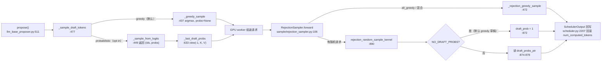
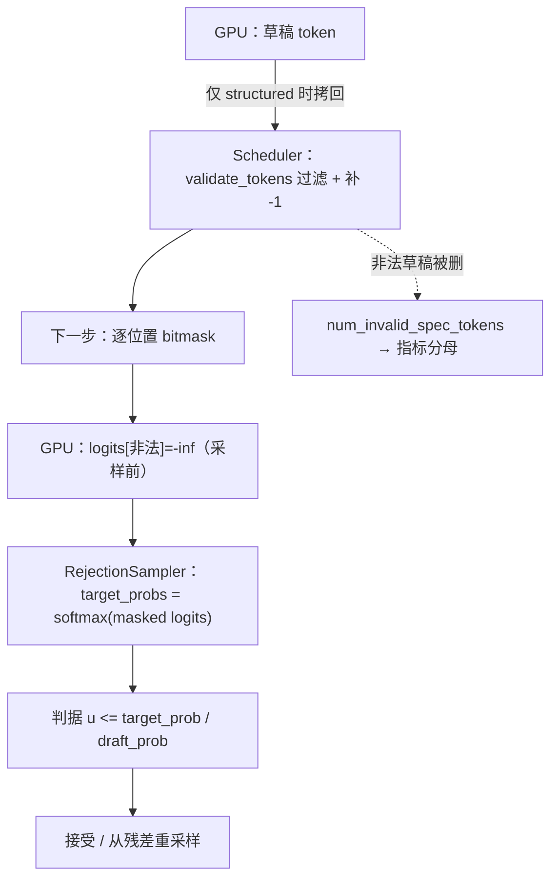

# 子文档：vLLM 调度、投机解码与语法约束的交互

> ⚠️ **信息来源声明**：本文由 AI Agent 基于公开开源仓库源码只读精读整理。所有行为结论标注 `文件:行`，区分「代码事实」与「研究推断」。
>
> **调研日期**：2026-10-16
> **主文档**：[report.md](report.md)
> **版本**：`vllm-project/vllm` @ `fa75d3456d60a5ffe923818c4b495295675b38e1`
> **证据标签**：单一主等级。vLLM 侧一律 **`[精读原文（vLLM 源码 @ 本报告 SHA）]`**；SGLang 侧一律 **`[精读原文（SGLang 源码 @ 2a08e261，经本仓库既有条目转引）]`**——对 vLLM 是直接一手核验，对 SGLang 是转引本仓库已完成的一手核验，本轮**未重新 clone SGLang**。
> **姊妹对照条目**：[SGLang speculative-decoding-path.md](../sglang/speculative-decoding-path.md)

---

## 1. 先给答案

1. **调度器没有 prefill/decode 两相**，它统一成"让 `num_computed_tokens` 追上 `num_tokens_with_spec`"（`[scheduler.py:623-641](<https://github.com/vllm-project/vllm/blob/fa75d3456d60a5ffe923818c4b495295675b38e1/vllm/v1/core/sched/scheduler.py>)`，`:623-632` 为 NOTE 注释段、实体代码自 `:634` 起、预算赋值在 `:641`）。chunked prefill 在 V1 里不是"一种模式"，而是**默认形态**：`:1216` 只在 `enable_chunked_prefill=False` 时才走"要么整段要么不排"。**[精读原文]**
2. **抢占释放请求持有的块、计数归零，再重新查前缀**：`num_computed_tokens = 0` + 回 waiting 队列（`[scheduler.py:1671](<https://github.com/vllm-project/vllm/blob/fa75d3456d60a5ffe923818c4b495295675b38e1/vllm/v1/core/sched/scheduler.py>)`、`:1692`）。V1 **没有 swap-out 路径**（本报告在 `vllm/v1/core/` 下未找到 CPU/磁盘换出实现；措辞按"未找到证据"处理）。**[精读原文 + 范围声明]**
3. **默认草稿是 one-hot**，且这一取舍**写在配置的 docstring 里、由 kernel 内的 `draft_prob = 1` 落地**（`[speculative.py:604](<https://github.com/vllm-project/vllm/blob/fa75d3456d60a5ffe923818c4b495295675b38e1/vllm/config/speculative.py>)`、`[rejection_sampler.py:871-872](<https://github.com/vllm-project/vllm/blob/fa75d3456d60a5ffe923818c4b495295675b38e1/vllm/v1/sample/rejection_sampler.py>)`（`:871` `if NO_DRAFT_PROBS:` → `:872` `draft_prob = 1`））。**[精读原文]**
4. **grammar 掩码后的 softmax 会在合法集上重新归一化**；旧/新 runner 分别调用自己的验证器，不能仅据掩码与 one-hot 判其有偏（§4.3）。

---

## 2. 调度：队列、预算与抢占

### 2.1 三条队列

| 队列 | 锚点 | 说明 |
|---|---|---|
| `waiting` | `[scheduler.py:223](<https://github.com/vllm-project/vllm/blob/fa75d3456d60a5ffe923818c4b495295675b38e1/vllm/v1/core/sched/scheduler.py>)` | 新请求 + 被抢占请求（`prepend_request` 到队首） |
| `running` | 隐含在 `self.running` list | 本步正在跑的请求 |
| `kv_holding_waiting` | `[scheduler.py:227](<https://github.com/vllm-project/vllm/blob/fa75d3456d60a5ffe923818c4b495295675b38e1/vllm/v1/core/sched/scheduler.py>)` | KV 交接中的请求（连接器/异步加载），**不计入 `waiting`** |

队列策略由 `SchedulingPolicy` 二选一：`FCFS`（`deque`）或 `PRIORITY`（`heapq` + `arrival_time` 平局裁决），见 `[request_queue.py:13-17](<https://github.com/vllm-project/vllm/blob/fa75d3456d60a5ffe923818c4b495295675b38e1/vllm/v1/core/sched/request_queue.py>)`（`SchedulingPolicy`，`FCFS` 在 `:16`、`PRIORITY` 在 `:17`）、`[request_queue.py:131-159](<https://github.com/vllm-project/vllm/blob/fa75d3456d60a5ffe923818c4b495295675b38e1/vllm/v1/core/sched/request_queue.py>)`（`PriorityRequestQueue`）。**[精读原文]**

### 2.2 预算：两个数字，不是三个

```
token_budget = self.max_num_scheduled_tokens                      # scheduler.py:641
input_budget = self.scheduler_config.max_num_batched_tokens       # scheduler.py:644
draft_slots  = spec.max_num_new_slots_for_drafting if spec else 0 # scheduler.py:643
```

**[精读原文]**

消耗规则（`:911-912`）**[精读原文]**：

```python
token_budget -= num_new_tokens
input_budget -= num_new_tokens + draft_slots
```

**研究推断**：`draft_slots` **只从 `input_budget` 扣**，且每次调度都要扣一次，即使这条请求这一步并没有真的用到那么多草稿槽位（`:716` 的 `if input_budget <= draft_slots: break` 是硬闸门）。这意味着**开 spec decode 会挤压可并发的输入 token 量**，机制上是输入预算的预留，而不是按需计费。

### 2.3 本节追踪的内存压力抢占位置

`[scheduler.py:832-899](<https://github.com/vllm-project/vllm/blob/fa75d3456d60a5ffe923818c4b495295675b38e1/vllm/v1/core/sched/scheduler.py>)` 是一个 `while True` 循环：调 `allocate_slots`，失败则选牺牲者、`_preempt_request`、再试；若牺牲者就是当前请求本身，`break` 放弃调度。**[精读原文]**

牺牲者选择（`:851-857`）**[精读原文]**：

```python
if self.policy == SchedulingPolicy.PRIORITY:
    preempted_req = max(self.running, key=lambda r: (r.priority, r.arrival_time))
else:
    preempted_req = self.running[-1]
```

**代码事实**：FCFS 下牺牲者是 `self.running[-1]`，即**运行队列末尾**。`:824-826` 的另一处注释明确说明调度器**不严格遵循 FCFS**（"by doing `continue` instead of `break`, we do not strictly follow the FCFS scheduling policy and allow the lower-priority requests to be scheduled"）。**[精读原文]**

### 2.4 抢占后的一致性处理

`_preempt_request`（`[scheduler.py:1649-1692](<https://github.com/vllm-project/vllm/blob/fa75d3456d60a5ffe923818c4b495295675b38e1/vllm/v1/core/sched/scheduler.py>)`）除了清 KV 与计数，还处理了**异步调度**的陈旧输出：

```python
request.drop_stale_output = drop_stale_output or (...)
request.num_stale_output_tokens = request.num_in_flight_tokens
request.num_output_placeholders = 0
```

**[精读原文]**

**研究推断**：`drop_stale_output` 的两个用途（reset_prefix_cache 与 "connectors with a pending KV hand-off"）在 docstring 里写明了（[`scheduler.py:1657-1660`](<https://github.com/vllm-project/vllm/blob/fa75d3456d60a5ffe923818c4b495295675b38e1/vllm/v1/core/sched/scheduler.py#L1657>)）；`:1674-1680` 的注释解释了为什么**不能直接丢**在途 token（"dropping them would perturb spec-decode acceptance"，原文在 `:1675`）。这说明**异步调度 + 抢占 + 投机解码三者叠在一起时，"什么算已生成"这一语义已经很微妙**，是维护风险点（`drop_stale_output` 赋值点 [`vllm/v1/core/sched/scheduler.py:1681`](<https://github.com/vllm-project/vllm/blob/fa75d3456d60a5ffe923818c4b495295675b38e1/vllm/v1/core/sched/scheduler.py#L1681>)，在途 token 语义见 [`vllm/v1/core/sched/scheduler.py:2205-2209`](<https://github.com/vllm-project/vllm/blob/fa75d3456d60a5ffe923818c4b495295675b38e1/vllm/v1/core/sched/scheduler.py#L2205>)）。

### 2.5 调度侧与投机解码的两个耦合点（锚点：[`vllm/v1/core/sched/scheduler.py:1189`](<https://github.com/vllm-project/vllm/blob/fa75d3456d60a5ffe923818c4b495295675b38e1/vllm/v1/core/sched/scheduler.py#L1189>) 的 `:1196` = `padded_num_tokens = 1 + self.num_spec_tokens`、[`vllm/v1/core/sched/scheduler.py:1672`](<https://github.com/vllm-project/vllm/blob/fa75d3456d60a5ffe923818c4b495295675b38e1/vllm/v1/core/sched/scheduler.py#L1672>)）

| 耦合点 | 代码 | 行为 |
|---|---|---|
| decode 对齐 padding | `[scheduler.py:1189-1208](<https://github.com/vllm-project/vllm/blob/fa75d3456d60a5ffe923818c4b495295675b38e1/vllm/v1/core/sched/scheduler.py>)`（补齐赋值在 `:1196-1207`） | 开 spec 且非 prefill 步时，单 token 的 decode 被 **padding 到 `1 + num_spec_tokens`** 以保住 uniform cudagraph；预算不够时**宁可这一步不排**（`break`） |
| 抢占时清草稿 | `[scheduler.py:1672-1673](<https://github.com/vllm-project/vllm/blob/fa75d3456d60a5ffe923818c4b495295675b38e1/vllm/v1/core/sched/scheduler.py>)` | `request.spec_token_ids = []`，避免旧草稿被跨抢占复用 |

**[精读原文]**

---

## 3. 投机解码：三段与判据

### 3.1 三段总览



**[精读原文（vLLM 源码 @ 本报告 SHA）]**

### 3.2 判据的确切数学形式

`rejection_random_sample_kernel`（定义在 `[rejection_sampler.py:829](<https://github.com/vllm-project/vllm/blob/fa75d3456d60a5ffe923818c4b495295675b38e1/vllm/v1/sample/rejection_sampler.py>)`）的内层循环（`[rejection_sampler.py:860-890](<https://github.com/vllm-project/vllm/blob/fa75d3456d60a5ffe923818c4b495295675b38e1/vllm/v1/sample/rejection_sampler.py>)`）**[精读原文]**：

```python
if draft_token_id < 0:
    accepted = False                      # -1 = padding，直接拒
elif SYNTHETIC_MODE:
    rate = tl.load(synthetic_conditional_rates_ptr + pos)
    accepted = uniform_prob < rate
else:
    if NO_DRAFT_PROBS:
        draft_prob = 1
    else:
        draft_prob = tl.load(draft_probs_ptr + (start_idx+pos)*vocab_size + draft_token_id)
    target_prob = tl.load(target_probs_ptr + (start_idx+pos)*vocab_size + draft_token_id)
    accepted = draft_prob > 0 and target_prob / draft_prob >= uniform_prob
```

即标准 Leviathan 判据 $u \le \min(1, p(x)/q(x))$（判据行 `[rejection_sampler.py:884](<https://github.com/vllm-project/vllm/blob/fa75d3456d60a5ffe923818c4b495295675b38e1/vllm/v1/sample/rejection_sampler.py>)`）；默认 greedy 草稿下 $q(x)=1$（其余token为0）（`:871-872`），判据退化为 $u \le p(x)$，**拒绝后需从排除被拒候选 $x$ 的条件残差采样**（直接实现见 `rejection_sampler.py:1044-1049` 的 `vocab_offset != draft_token_id`；一般分布见 `:1061` 的 `max(p-q,0)`；入口为`[rejection_sampler.py:492-502](<https://github.com/vllm-project/vllm/blob/fa75d3456d60a5ffe923818c4b495295675b38e1/vllm/v1/sample/rejection_sampler.py>)`）。**[精读原文 + 研究推断]**

**与 SGLang 的有条件单步对照**：topk=1、两个阈值均为1、确定性草稿时，SGLang在工作缓冲记录已拒候选（`sampling.cuh:93`），vLLM在kernel里直接排除草稿候选（`rejection_sampler.py:1044-1049`）；两侧可以得到相同的条件残差。张量初始化不同不等于数学分布不同，SGLang的全零缓冲也不表示提议分布 $q=0$。多分支树、随机草稿和阈值修改必须另行追踪。

### 3.3 草稿概率的供给链（旧路径 / 新路径）

| 路径 | 载体 | 锚点 |
|---|---|---|
| 旧（`vllm/v1/sample/`） | `draft_probs: torch.Tensor \| None`，形状 `[num_tokens, vocab_size]` | `[rejection_sampler.py:106-121](<https://github.com/vllm-project/vllm/blob/fa75d3456d60a5ffe923818c4b495295675b38e1/vllm/v1/sample/rejection_sampler.py>)` |
| 新（`vllm/v1/worker/gpu/spec_decode/`） | `draft_logits: [max_num_reqs, num_speculative_steps, V] \| None` | `[rejection_sampler_utils.py:1020-1024](<https://github.com/vllm-project/vllm/blob/fa75d3456d60a5ffe923818c4b495295675b38e1/vllm/v1/worker/gpu/spec_decode/rejection_sampler_utils.py>)` |
| 供给点（proposer） | `_last_draft_probs = draft_probs.view(-1, K, V)` | `[llm_base_proposer.py:629-635](<https://github.com/vllm-project/vllm/blob/fa75d3456d60a5ffe923818c4b495295675b38e1/vllm/v1/spec_decode/llm_base_proposer.py>)` |
| 供给点（worker 取回） | `if hasattr(self.drafter, "take_last_draft_probs"): ...` | `[gpu_model_runner.py:4987-4990](<https://github.com/vllm-project/vllm/blob/fa75d3456d60a5ffe923818c4b495295675b38e1/vllm/v1/worker/gpu_model_runner.py>)` |
| 开关 | `_enable_probabilistic_draft_probs = (rejection_sample_method=="standard" and draft_sample_method=="probabilistic")` | `[llm_base_proposer.py:257-260](<https://github.com/vllm-project/vllm/blob/fa75d3456d60a5ffe923818c4b495295675b38e1/vllm/v1/spec_decode/llm_base_proposer.py>)` |

**[精读原文]**

**研究推断**：这条链上有 **两个独立开关**（`rejection_sample_method` 与 `draft_sample_method`），但只有**它们的合取**才真正产出概率。也就是说：单独设 `rejection_sample_method="synthetic"` 而不设 `probabilistic`，走的是"合成接受率"第三条路（`[speculative.py:533-547](<https://github.com/vllm-project/vllm/blob/fa75d3456d60a5ffe923818c4b495295675b38e1/vllm/config/speculative.py>)`，`:533` 是 `rejection_sample_method`、`:541` 是 `synthetic_acceptance_rates`）。**三条验证语义（standard / synthetic / block）与两种草稿语义（greedy / probabilistic）是正交的**——这一点文档里有，但代码里没有任何地方把它们合并成一个"当前实际用哪套数学"的统一输出。**[精读原文 + 研究推断]**

### 3.4 口径：`num_draft_tokens` 是"语法过滤后"的数

- 分母的定义在 `[stats.py:367-368](<https://github.com/vllm-project/vllm/blob/fa75d3456d60a5ffe923818c4b495295675b38e1/vllm/v1/metrics/stats.py>)`："Total proposed draft tokens, after the grammar-invalidated (`num_invalid_spec_tokens`) adjustment."
- 减项的产生在 `[scheduler.py:3058](<https://github.com/vllm-project/vllm/blob/fa75d3456d60a5ffe923818c4b495295675b38e1/vllm/v1/core/sched/scheduler.py>)`：`num_draft_tokens -= num_invalid_spec_tokens.get(request_id, 0)`
- 同口径在请求级指标里重复一次（`[scheduler.py:2221-2228](<https://github.com/vllm-project/vllm/blob/fa75d3456d60a5ffe923818c4b495295675b38e1/vllm/v1/core/sched/scheduler.py>)`）
- 文档口径确认在 `[acceptance_metrics.md:67](<https://github.com/vllm-project/vllm/blob/fa75d3456d60a5ffe923818c4b495295675b38e1/docs/features/speculative_decoding/acceptance_metrics.md>)`

**[精读原文]**

**研究推断**：这是**同一个量在两处被减去**（`make_spec_decoding_stats` 与 `request.spec_decode_metrics.observe`）——两处都各自减了一次，但作用于不同的累加器，所以不构成重复扣减。**不过对读指标的人来说，"draft acceptance rate" 的分母在开启 structured output 时会系统性偏小（非法草稿被剔除），因此该指标在不同约束强度下不可直接横比。** 这是我建议在运维看板上加注的一条。**[研究推断]**

---

## 4. 与语法约束（structured output）的完整交互链

### 4.1 五步

| 步 | 位置 | 做了什么 |
|---|---|---|
| 1 | `[spec_decode/utils.py:64-68](<https://github.com/vllm-project/vllm/blob/fa75d3456d60a5ffe923818c4b495295675b38e1/vllm/v1/worker/gpu/spec_decode/utils.py>)` | **仅当 batch 含 structured output 请求**时，才把草稿 token 异步拷回 CPU |
| 2 | `[scheduler.py:2679-2686](<https://github.com/vllm-project/vllm/blob/fa75d3456d60a5ffe923818c4b495295675b38e1/vllm/v1/core/sched/scheduler.py>)` | `validate_tokens` 过滤非法草稿，缺失位置补 `-1`，计入 `num_invalid_spec_tokens` |
| 3 | `[structured_output/__init__.py:455-489](<https://github.com/vllm-project/vllm/blob/fa75d3456d60a5ffe923818c4b495295675b38e1/vllm/v1/structured_output/__init__.py>)` | 逐位置填 bitmask；被拒草稿之后复用最后一个合法状态的 bitmask（`failed_index`，`:458`/`:488`） |
| 4 | `[structured_outputs.py:195-198](<https://github.com/vllm-project/vllm/blob/fa75d3456d60a5ffe923818c4b495295675b38e1/vllm/v1/worker/gpu/structured_outputs.py>)`（`-float("inf")` 在 `:197`、mask 在 `:198`） | kernel 就地（in-place）把非法 token 的 logits 写成 `-float("inf")` |
| 5 | `[model_runner.py:1636](<https://github.com/vllm-project/vllm/blob/fa75d3456d60a5ffe923818c4b495295675b38e1/vllm/v1/worker/gpu/model_runner.py>)`（调用 `apply_grammar_bitmask`）vs `:1655`（`self.sampler`） | 掩码在 `self.sampler(...)` **之前**；新 runner 随后调用自己的 `rejection_sampler`（`:1662`）；旧 runner 的独立链在 §4.3 列出，旧验证器对 masked logits 做 `softmax`（`[rejection_sampler.py:487](<https://github.com/vllm-project/vllm/blob/fa75d3456d60a5ffe923818c4b495295675b38e1/vllm/v1/sample/rejection_sampler.py>)`） |

**[精读原文]**

### 4.2 因果链



**[精读原文（vLLM 源码 @ 本报告 SHA）]**

### 4.3 两套runner与归一化（以下锚点分属不同路径；掩码施加点 [`vllm/v1/worker/gpu/model_runner.py:1636`](<https://github.com/vllm-project/vllm/blob/fa75d3456d60a5ffe923818c4b495295675b38e1/vllm/v1/worker/gpu/model_runner.py#L1636>)；验证取值点 [`vllm/v1/sample/rejection_sampler.py:487`](<https://github.com/vllm-project/vllm/blob/fa75d3456d60a5ffe923818c4b495295675b38e1/vllm/v1/sample/rejection_sampler.py#L487>)）

**代码事实**：

- 已追踪的草稿生成路径未见逐token grammar 掩码；正面证据是目标端先做mask、验证端单独接收 `invalid_drafts`（`worker/gpu/model_runner.py:1633-1646,1662-1667`；新验证器 `worker/gpu/spec_decode/rejection_sampler.py:427-433`）。这不等于已穷举全部spec算法或证明全仓没有其他掩码路径。
- 非法草稿的处理是"**事后删除 + 下一步补位**"，不是"**事前掩码**"。**[精读原文]**
- 验证用的 `target_probs` 来自**已被掩码**的 logits（步 4 在步 5 之前）。**[精读原文]**

**数学解释**：掩码后 softmax 的目标是合法集上的归一化分布 $p_A$，与“不带语法约束的原始分布”不同是约束解码的预期效果，不能据此推断验证与输出分布错配。旧路径的入口应写成 `gpu_model_runner.py:4329-4335` → `_sample` → `:3455` → `vllm/v1/sample/rejection_sampler.py:487`；`worker/gpu/model_runner.py:1662` 则调用新路径 `worker/gpu/spec_decode/rejection_sampler.py`，在 `:427-433` 将非法草稿标成 `-1`。两条路径必须分开核验。

**确定性草稿的推导**：若实际提议是 $q=\delta_x$，则接受概率为 $p_A(x)$，拒绝残差为 $r(x)=0$、$r(y)=p_A(y)/(1-p_A(x))$（$y\ne x$）。接受与残差混合恢复 $p_A$，one-hot 本身不带来偏差。`rejection_sampler.py:1044-1049` 实现了排除 $x$ 的权重；`draft_sample_method=probabilistic` 时则必须传递实际采样的 $q$。本文不据此替所有 grammar、数值与多步路径做正确性证明。

### 4.4 一个可观测的旁证

`[spec_decode/utils.py:88](<https://github.com/vllm-project/vllm/blob/fa75d3456d60a5ffe923818c4b495295675b38e1/vllm/v1/worker/gpu/spec_decode/utils.py>)` 在**没有** structured output 请求且异步调度关闭时，把草稿 token 填成 `[[-1] * self.num_draft_tokens ...]`。而 `-1` 在验证 kernel 里就是"直接拒"（`[rejection_sampler.py:864-866](<https://github.com/vllm-project/vllm/blob/fa75d3456d60a5ffe923818c4b495295675b38e1/vllm/v1/sample/rejection_sampler.py>)`，`accepted = False` 在 `:866`），在语法侧则被 `strip_speculative_padding` 截断（`[structured_output/utils.py:48-58](<https://github.com/vllm-project/vllm/blob/fa75d3456d60a5ffe923818c4b495295675b38e1/vllm/v1/structured_output/utils.py>)`，返回语句 `:58`）。**[精读原文]**

**研究推断**：`-1` 是一个**跨三个子系统共享的哨兵**（worker 的占位、kernel 的拒绝、grammar 的截断）。任何新增"草稿位置"语义的改动都必须同时照顾这三处，是明确的维护触点。

---

## 5. 与 SGLang 的对照（**带条件列**）

| 维度 | 条件 | vLLM @ `fa75d345` | SGLang @ `2a08e261` |
|---|---|---|---|
| 调度相态 | 一般情况 | 无 prefill/decode 两相（`scheduler.py:623-641`） | 有 prefill / decode 两条 batch 构造路径（[scheduler-and-prefix-cache.md §4](../sglang/scheduler-and-prefix-cache.md)） |
| 抢占恢复 | 一般情况 | **计数归零后重新准入（可复用尚存前缀）**（`scheduler.py:1671`） | 本报告未核验，不填 |
| 草稿采样 | `draft_sample_method="greedy"`（**vLLM 默认**） | argmax 且不产概率（`llm_base_proposer.py:454`） | topk=1 时 `ret_topk_p = torch.ones_like(...)`（[speculative-decoding-path.md §3.1](../sglang/speculative-decoding-path.md)） |
| 默认验证判据 | greedy 草稿 + 随机目标 | $u \le p(x)$（$q$ 被置 1，`rejection_sampler.py:871-884`：`:871` `if NO_DRAFT_PROBS:`、`:872` `draft_prob = 1`、`:884` 判据） | `coin < prob_acc / threshold_acc`（`draft_probs` 置零，走 target-only kernel）（[speculative-decoding-path.md §4.2](../sglang/speculative-decoding-path.md)） |
| 严格验证判据 | `probabilistic` / `--speculative-use-rejection-sampling` | $u \le p(x)/q(x)$（`rejection_sampler.py:881`） | `coin * q < p`（[speculative-decoding-path.md §4.3](../sglang/speculative-decoding-path.md)） |
| 验证语义可选项 | 配置组合 | 3 种 `rejection_sample_method`（standard / synthetic / block）+ 2 种 `draft_sample_method`（`speculative.py:533`、`:604`） | 2 条路径（目标-only / 严格拒绝采样） |
| 语法约束下的草稿 | 开启 structured output | **事后删除非法草稿** + 下一步逐位置 bitmask（`scheduler.py:2679`、`structured_output/__init__.py:455-489`） | 本报告未核验，不填 |
| 验证所用目标分布 | 开启 structured output | 对掩码后 logits 重新归一化的 softmax（旧 `gpu_model_runner.py:4329-4335` → `:3455` → `v1/sample/rejection_sampler.py:487`） | 未核验 |
| 指标口径 | 开启 structured output | `num_draft_tokens` **已扣除**语法非法草稿（`stats.py:367`） | 未核验 |

**[精读原文：vLLM 列来自 vLLM @ `fa75d345`；SGLang 列转引本仓库既有条目]**。空白格保持空白——**不填没读过的格子**。

### 5.1 两处不像"同一件事"的地方（需要显式说明）

1. **默认路径的权重表示不同**（§3.2）：vLLM 是 $q \leftarrow 1$ 走通用公式，SGLang 是 $q \leftarrow 0$ 走特判分支。**在 topk=1、阈值均为 1、确定性草稿条件下，两侧接受概率为目标概率，拒绝后都需排除被拒候选，但推导路径不可互相引用。**
2. **"占位符"的选择不同**：vLLM 用 `-1` 贯穿 worker / kernel / grammar 三处（§4.4）；SGLang 在新树上的 padding 语义本报告未核验。

---

## 6. 维护者笔记（调度与 spec 侧）

1. **改调度前先问"哪一档预算耗尽"**：`token_budget`（`:641`）与 `input_budget`（`:644`）是两个独立预算。**[精读原文]**
2. **"为什么这条请求没排上"的三种原因**：预算不够（`:716`、`:810`）、块不够（`:843-899`）、或 `long_prefill_token_threshold` 主动让位（`:673-688`，注释原文是"stop a long prefill from starving other requests"）。**[精读原文]**
3. **动结构化输出 + 投机解码之前，把 §4.1 的五步走一遍**：任何一步变化都会改变验证所用的目标分布。
4. **`-1` 是共享哨兵**（§4.4），改动需同步三处。
5. **本报告未核验**：vLLM 是否有与 SGLang `event_loop_overlap` 对应的调度重叠机制；`vllm/v1/worker/gpu/model_runner.py` 与 `gpu_model_runner.py` 的默认关系。**这两条不作为结论使用。**
