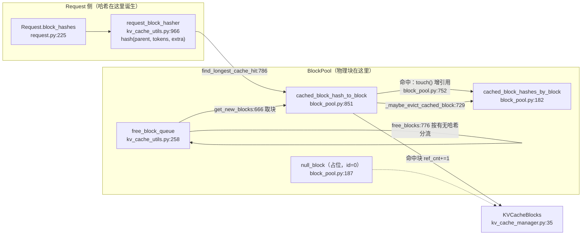

# 子文档：vLLM KV 缓存、块池与前缀复用

> ⚠️ **信息来源声明**：本文由 AI Agent 基于公开开源仓库源码只读精读整理。所有行为结论标注 `文件:行`，区分「代码事实」与「研究推断」。
>
> **调研日期**：2026-10-16
> **主文档**：[report.md](report.md)
> **版本**：`vllm-project/vllm` @ `fa75d3456d60a5ffe923818c4b495295675b38e1`
> **证据标签**：单一主等级；本文一律 **`[精读原文（vLLM 源码 @ 本报告 SHA）]`**，设计解释处标 **`[研究推断]`**。
> **姊妹对照条目**：[SGLang scheduler-and-prefix-cache.md](../sglang-research/scheduler-and-prefix-cache.md)

---

## 1. 先给答案

1. **PagedAttention 在 V1 里不是一棵树，而是一张"链式哈希 → 物理块"的字典 + 一条按淘汰序排列的空闲链表。** 三个结构定义了全部语义：`BlockHashToBlockMap`（`[block_pool.py:35](<https://github.com/vllm-project/vllm/blob/fa75d3456d60a5ffe923818c4b495295675b38e1/vllm/v1/core/block_pool.py>)`）、`FreeKVCacheBlockQueue`（`[kv_cache_utils.py:258](<https://github.com/vllm-project/vllm/blob/fa75d3456d60a5ffe923818c4b495295675b38e1/vllm/v1/core/kv_cache_utils.py>)`）、`BlockPool`（`[block_pool.py:136](<https://github.com/vllm-project/vllm/blob/fa75d3456d60a5ffe923818c4b495295675b38e1/vllm/v1/core/block_pool.py>)`）。**[精读原文]**
2. **哈希是"累积"的，因此命中自动蕴含前缀全同**：`hash(parent_hash, block_tokens, extra_keys)`（`[kv_cache_utils.py:1003](<https://github.com/vllm-project/vllm/blob/fa75d3456d60a5ffe923818c4b495295675b38e1/vllm/v1/core/kv_cache_utils.py>)`）。代价是**任何一处不匹配，其后全部失效**，亚块粒度的共享前缀无法复用。**[精读原文]**
3. **淘汰没有独立触发者**：`get_new_blocks` 每拿到一个块就顺手清它的哈希（`[block_pool.py:686](<https://github.com/vllm-project/vllm/blob/fa75d3456d60a5ffe923818c4b495295675b38e1/vllm/v1/core/block_pool.py>)`）。"淘汰"是分配路径的副作用。**[精读原文]**

---

## 2. PagedAttention 的 V1 实现形态

### 2.1 历史文档已经自我作废

`[docs/design/paged_attention.md:3](<https://github.com/vllm-project/vllm/blob/fa75d3456d60a5ffe923818c4b495295675b38e1/docs/design/paged_attention.md>)` 原文：

> "This is a historical document based on the [original paper for vLLM](https://arxiv.org/abs/2309.06180). It no longer describes the code used in vLLM today."

该文档仍描述 `csrc/attention/attention_kernels.cu`。**本报告的 KV 管理结论一律不引用该文档**，只引用 `vllm/v1/core/` 的代码。**[精读原文（vLLM 仓库文档 @ 本报告 SHA）]**

### 2.2 三层结构

| 层 | 结构 | 职责 | 锚点 |
|---|---|---|---|
| 索引层 | `BlockHashToBlockMap` | `hash → KVCacheBlock`，支持一个哈希对应多块（同哈希重复块）；实例在 `[block_pool.py:851](<https://github.com/vllm-project/vllm/blob/fa75d3456d60a5ffe923818c4b495295675b38e1/vllm/v1/core/block_pool.py>)` | `[block_pool.py:35](<https://github.com/vllm-project/vllm/blob/fa75d3456d60a5ffe923818c4b495295675b38e1/vllm/v1/core/block_pool.py>)` |
| 空闲层 | `FreeKVCacheBlockQueue` | 双向链表，按淘汰序排列；**为支持 O(1) 中间删除**才不用 `deque`；实例在 `[block_pool.py:178](<https://github.com/vllm-project/vllm/blob/fa75d3456d60a5ffe923818c4b495295675b38e1/vllm/v1/core/block_pool.py>)` | `[kv_cache_utils.py:258-274](<https://github.com/vllm-project/vllm/blob/fa75d3456d60a5ffe923818c4b495295675b38e1/vllm/v1/core/kv_cache_utils.py>)` |
| 池层 | `BlockPool` | 分配 / 释放 / 缓存 / 淘汰 / 事件 | `[block_pool.py:136](<https://github.com/vllm-project/vllm/blob/fa75d3456d60a5ffe923818c4b495295675b38e1/vllm/v1/core/block_pool.py>)` |

`FreeKVCacheBlockQueue` 的 docstring 把淘汰序写死了两条（`[kv_cache_utils.py:267-274](<https://github.com/vllm-project/vllm/blob/fa75d3456d60a5ffe923818c4b495295675b38e1/vllm/v1/core/kv_cache_utils.py>)`）**[精读原文]**：

1. "The least recent used block is at the front (LRU)."
2. "If two blocks have the same last accessed time (allocated by the same sequence), the one with more hash tokens (the tail of a block chain) is at the front."

第 2 条是**链式哈希的直接后果**：同一条链上越靠后的块，它的哈希覆盖的前缀越长；淘汰时优先丢"依赖别人更多的"块，等价于"先砍尾巴再砍身子"。**[研究推断]**

### 2.3 块表：append-only

`BlockTable` 是一个 `[max_num_reqs, max_num_blocks_per_req]` 的 int32 缓冲（`[block_table.py:80-83](<https://github.com/vllm-project/vllm/blob/fa75d3456d60a5ffe923818c4b495295675b38e1/vllm/v1/worker/block_table.py>)`），只有"追加行"和"整行搬移"两种写操作（`append_row:114`、`move_row:137`）。**[精读原文]**

`[docs/design/prefix_caching.md:194](<https://github.com/vllm-project/vllm/blob/fa75d3456d60a5ffe923818c4b495295675b38e1/docs/design/prefix_caching.md>)` 把这条设计约束与其后果写在一起（原文要点）：v0 在检测到重复块时会释放新块并让请求改用旧块，**v1 的 block table 是 append-only，因此不允许把 `[0, 3]` 改写成 `[0, 1]`**，重复块要等到请求释放才消除。**[精读原文（vLLM 仓库文档 @ 本报告 SHA）]**

**研究推断**：append-only 换来了"块表不需要在 token 生成路径上回写"，代价是**同前缀 KV 存在多份**——这在内存账本上是可观测的浪费，也是它与 SGLang"插入时立刻释放重复 KV 槽位"（[scheduler-and-prefix-cache.md §3.4](../sglang-research/scheduler-and-prefix-cache.md)）最直接的分歧点。

---

## 3. 前缀查找与写入的运行时细节

### 3.1 查找：两阶段，首 miss 即停

`FullAttentionManager.find_longest_cache_hit`（`[single_type_kv_cache_manager.py:735](<https://github.com/vllm-project/vllm/blob/fa75d3456d60a5ffe923818c4b495295675b38e1/vllm/v1/core/single_type_kv_cache_manager.py>)`）：

- **Phase 1**（`:784-792`）：从块 0 起 `itertools.islice(full_block_hashes, max_length // block_size)`，逐块 `block_pool.get_cached_block(block_hash, kv_cache_group_ids)`，**`break` on first miss**。注释原文："A missing block implies every later block misses too (chained hashes)." **[精读原文]**
- **Phase 2**（`:796-815`，仅 fine-grained）：进入第一个非满块内部，从高位到低位探测 hash 边界。这是 `--prefix-match-unit` 把哈希粒度调小于 block size 时生效的路径（细粒度判定见 [`vllm/v1/core/single_type_kv_cache_manager.py:769`](<https://github.com/vllm-project/vllm/blob/fa75d3456d60a5ffe923818c4b495295675b38e1/vllm/v1/core/single_type_kv_cache_manager.py#L769>)，探测循环见 [`vllm/v1/core/single_type_kv_cache_manager.py:806`](<https://github.com/vllm-project/vllm/blob/fa75d3456d60a5ffe923818c4b495295675b38e1/vllm/v1/core/single_type_kv_cache_manager.py#L806>)）。**[精读原文]**

`KVCacheManager.get_computed_blocks` 在调用前做了一次**截断**：`max_cache_hit_length = request.num_tokens - 1`（`[kv_cache_manager.py:295](<https://github.com/vllm-project/vllm/blob/fa75d3456d60a5ffe923818c4b495295675b38e1/vllm/v1/core/kv_cache_manager.py>)`），注释解释了原因与代价（`:289-294`）**[精读原文]**：

> "When all tokens hit the cache, we must recompute the last token to obtain logits." … "This can trigger recomputation of an entire block, rather than just the single last token, because allocate_slots() requires num_computed_tokens to be block-size aligned. Removing this limitation could slightly improve performance in the future."

**研究推断**：这是"全命中"场景的**已知代价**，仓库用注释承认它、并明确标注为未来可优化点。它不是 bug，是块对齐约束的直接推论（块对齐约束在 [`vllm/v1/core/kv_cache_manager.py:292`](<https://github.com/vllm-project/vllm/blob/fa75d3456d60a5ffe923818c4b495295675b38e1/vllm/v1/core/kv_cache_manager.py#L292>) 与 [`vllm/v1/core/single_type_kv_cache_manager.py:827`](<https://github.com/vllm-project/vllm/blob/fa75d3456d60a5ffe923818c4b495295675b38e1/vllm/v1/core/single_type_kv_cache_manager.py#L827>)）。

### 3.2 写入：只写满块，且哈希在 Request 侧算

`cache_full_blocks`（`[block_pool.py:226](<https://github.com/vllm-project/vllm/blob/fa75d3456d60a5ffe923818c4b495295675b38e1/vllm/v1/core/block_pool.py>)`）的 docstring 明确："The block hashes values are computed by the Request object immediately when it is created and when new tokens are appended." **[精读原文]**

`Request.update_block_hashes`（`[request.py:285-288](<https://github.com/vllm-project/vllm/blob/fa75d3456d60a5ffe923818c4b495295675b38e1/vllm/v1/request.py>)`）通过 `_block_hasher` 回调增量追加哈希；而 hasher 本身在 `[kv_cache_utils.py:993](<https://github.com/vllm-project/vllm/blob/fa75d3456d60a5ffe923818c4b495295675b38e1/vllm/v1/core/kv_cache_utils.py>)` 对非满块直接 `return []`。**[精读原文]**

**研究推断**：把哈希计算放在 Request 侧（而非 KV 管理器侧）意味着**哈希是请求状态的函数，不是内存状态的函数**；因此同一条请求被抢占重算时，它的哈希序列不会变——这是 §4.2 讨论的基础。

### 3.3 分配：`get_new_blocks` 即淘汰点

```
get_new_blocks(n)  (block_pool.py:666)
  → free_block_queue.popleft_n(n)
  → for block in ret: _maybe_evict_cached_block(block)   # :686  ← 淘汰在这里发生
  → assert block.ref_cnt == 0; block.ref_cnt += 1
```

**[精读原文]**

`_maybe_evict_cached_block`（`[block_pool.py:729](<https://github.com/vllm-project/vllm/blob/fa75d3456d60a5ffe923818c4b495295675b38e1/vllm/v1/core/block_pool.py>)`）做三件事：通知 metrics、`_remove_cached_block_hashes(block)` 摘掉哈希、发 `BlockRemoved` 事件。**[精读原文]**

### 3.4 释放：按"有无哈希"分流

`free_blocks`（`[block_pool.py:776](<https://github.com/vllm-project/vllm/blob/fa75d3456d60a5ffe923818c4b495295675b38e1/vllm/v1/core/block_pool.py>)`）是全部淘汰语义的所在（`:793-799`）**[精读原文]**：

```python
if block.block_hash is None or not self.enable_caching:
    # LIFO reuse of non-cached blocks for better GPU locality.
    blocks_to_evict_first.append(block)
else:
    # FIFO reuse of cached blocks for LRU eviction behavior.
    blocks_to_evict_last.append(block)
...
self.free_block_queue.prepend_n(blocks_to_evict_first)
self.free_block_queue.append_n(blocks_to_evict_last)
```

**研究推断**：这里把两种**相互冲突的目标**（GPU 局部性 vs 前缀复用价值）用"有没有哈希"这一个判据切开了。它的隐含假设是"没哈希的块永远不可能被 APC 命中"——这与 `[kv_cache_utils.py:993](<https://github.com/vllm-project/vllm/blob/fa75d3456d60a5ffe923818c4b495295675b38e1/vllm/v1/core/kv_cache_utils.py>)`"只哈希满块"是配套的：部分填充的尾块天然无哈希，复用价值低，所以让它先被复用（LIFO）。

### 3.5 额外机制：`unpin_blocks` 与 reuse watcher

`unpin_blocks`（`[block_pool.py:708](<https://github.com/vllm-project/vllm/blob/fa75d3456d60a5ffe923818c4b495295675b38e1/vllm/v1/core/block_pool.py>)`）的 docstring 原文：

> "Release references to blocks that stay readable until reused. The blocks become last-resort eviction candidates regardless of prefix caching: they join the tail of the free queue and count as free. `on_reuse` fires when `get_new_blocks` hands a block out (or the cache is reset), so the caller can stop reading it."

这是给**异步读取方**（如 KV 连接器、encoder 复用）留的窗口：块已被逻辑释放、但物理内容还要被读，于是挂 `_reuse_watchers` 回调。**[精读原文]**

---

## 4. 调度器的 KV 侧接口

### 4.1 `allocate_slots` 的五段布局

`[kv_cache_manager.py:417-460](<https://github.com/vllm-project/vllm/blob/fa75d3456d60a5ffe923818c4b495295675b38e1/vllm/v1/core/kv_cache_manager.py>)` 的 docstring 画出并定义了：

```
| < comp > | < new_comp > | < ext_comp > | < new > | < lookahead > |
```

并给出三段式算法：先释放 `comp` 中不必要的块并检查余量 → 处理前缀 token（`comp + new_comp + ext_comp`，含滑窗外的释放）→ 为待计算 token（`new + lookahead`）分配。**返回 `None` 表示余量不足**，调度器据此抢占。**[精读原文]**

docstring 还写明一条对投机解码重要的约束（`:455-457`）[精读原文]：

> "NOTE: for new tokens which include both verified and unverified draft tokens, we only cache the verified tokens (by capping the number at `request.num_tokens`)."

**研究推断**：这条把"未验证的草稿 KV 不能进前缀缓存"变成接口级不变式——否则被拒草稿会污染缓存，产生错误复用。

### 4.2 抢占重算与前缀缓存的交互

`_preempt_request`（`[scheduler.py:1649](<https://github.com/vllm-project/vllm/blob/fa75d3456d60a5ffe923818c4b495295675b38e1/vllm/v1/core/sched/scheduler.py>)`）的顺序是：

```
_free_request_blocks(request)          # scheduler.py:1664
encoder_cache_manager.free(request)
request.status = RequestStatus.PREEMPTED
request.num_computed_tokens = 0        # scheduler.py:1671
request.spec_token_ids = []            # :1672-1673
...
self.waiting.prepend_request(request)  # scheduler.py:1692
```

**[精读原文]**

**研究推断（需要显式标注为推断）**：被打回的请求下一轮会重新走 `get_computed_blocks` → `find_longest_cache_hit`。它的 `block_hashes` 是按**已写入 token 数**派生的，而重算时 `num_computed_tokens = 0`（[`vllm/v1/core/sched/scheduler.py:1671`](<https://github.com/vllm-project/vllm/blob/fa75d3456d60a5ffe923818c4b495295675b38e1/vllm/v1/core/sched/scheduler.py#L1671>)），命中长度必须落到块边界（[`vllm/v1/core/single_type_kv_cache_manager.py:827`](<https://github.com/vllm-project/vllm/blob/fa75d3456d60a5ffe923818c4b495295675b38e1/vllm/v1/core/single_type_kv_cache_manager.py#L827>)）。因此：

- 若该请求此前**已经生成过若干完整块且这些块的哈希仍在表中**（同一批其他请求还在引用，或未被淘汰），则命中数 > 0，重算量小于全长；
- 若这些块已被自己释放后**立即被别的请求取走**（没有任何 GC 窗口），则命中数 = 0，退化为全长重算。

**我没有找到"抢占后保留该请求自身块"的机制**——`_free_request_blocks` 是立刻执行的。**"退化为零块"这一点我没有找到逐行证据，属于推断**，需要单独构造实验（打印 `num_preemptions` 与 `get_computed_blocks` 命中数）才能确证。**已记入本条目「未确证 / 待跟踪」。**

---

## 5. 与前缀缓存相关的三个已知边界（锚点：[`vllm/v1/core/kv_cache_utils.py:993`](<https://github.com/vllm-project/vllm/blob/fa75d3456d60a5ffe923818c4b495295675b38e1/vllm/v1/core/kv_cache_utils.py#L993>)、[`vllm/v1/core/kv_cache_manager.py:295`](<https://github.com/vllm-project/vllm/blob/fa75d3456d60a5ffe923818c4b495295675b38e1/vllm/v1/core/kv_cache_manager.py#L295>)、[`docs/design/prefix_caching.md:194`](<https://github.com/vllm-project/vllm/blob/fa75d3456d60a5ffe923818c4b495295675b38e1/docs/design/prefix_caching.md#L194>)）

| 边界（锚点：[`vllm/v1/core/kv_cache_utils.py:993`](<https://github.com/vllm-project/vllm/blob/fa75d3456d60a5ffe923818c4b495295675b38e1/vllm/v1/core/kv_cache_utils.py#L993>)） | 代码事实 | 影响面 |
|---|---|---|
| 只缓存满块 | `[kv_cache_utils.py:993](<https://github.com/vllm-project/vllm/blob/fa75d3456d60a5ffe923818c4b495295675b38e1/vllm/v1/core/kv_cache_utils.py>)` | 尾块永远不可复用；短 prompt 命中率结构性偏低 |
| 全命中也得重算最后一段 | `[kv_cache_manager.py:289-299](<https://github.com/vllm-project/vllm/blob/fa75d3456d60a5ffe923818c4b495295675b38e1/vllm/v1/core/kv_cache_manager.py>)` | 至少重算一个块 |
| 块表 append-only，重复块延迟合并 | `[prefix_caching.md:194](<https://github.com/vllm-project/vllm/blob/fa75d3456d60a5ffe923818c4b495295675b38e1/docs/design/prefix_caching.md>)` | 同前缀多份物理块 |

---

## 6. 图：KV 侧的数据流



**[精读原文（vLLM 源码 @ 本报告 SHA）]**

---

## 7. 维护者笔记（KV 侧）

1. **改任何块生命周期逻辑前，先确认 `ref_cnt` 的三条不变式**：`get_new_blocks` 里 `assert block.ref_cnt == 0`、`unpin_blocks` 里 `assert block.ref_cnt > 0 and not block.is_null`、`free_blocks` 里 `null_block` 直接 `continue`。**[精读原文]**
2. **`null_block` 是哨兵不是普通块**：`[block_pool.py:184-188](<https://github.com/vllm-project/vllm/blob/fa75d3456d60a5ffe923818c4b495295675b38e1/vllm/v1/core/block_pool.py>)` 的注释原文 "The ref_cnt of null_block is not maintained, needs special care to avoid freeing it." **[精读原文]**
3. **多个 KV group（混合模型）时查找是"所有 group 都有才算命中"**：`get_cached_block` 对 `kv_cache_group_ids` 逐个查，任一 miss 即 `None`（`[block_pool.py:213-224](<https://github.com/vllm-project/vllm/blob/fa75d3456d60a5ffe923818c4b495295675b38e1/vllm/v1/core/block_pool.py>)`）。**[精读原文]**
4. **`hash_block_size` 与 group block_size 可以不等**：构造参数文档在 `[block_pool.py:147-150](<https://github.com/vllm-project/vllm/blob/fa75d3456d60a5ffe923818c4b495295675b38e1/vllm/v1/core/block_pool.py>)`，粗粒度 group 通过 `BlockHashListWithBlockSize`（`[kv_cache_utils.py:1111](<https://github.com/vllm-project/vllm/blob/fa75d3456d60a5ffe923818c4b495295675b38e1/vllm/v1/core/kv_cache_utils.py>)`）直接复用细粒度哈希。**[精读原文]**
