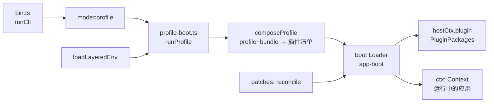
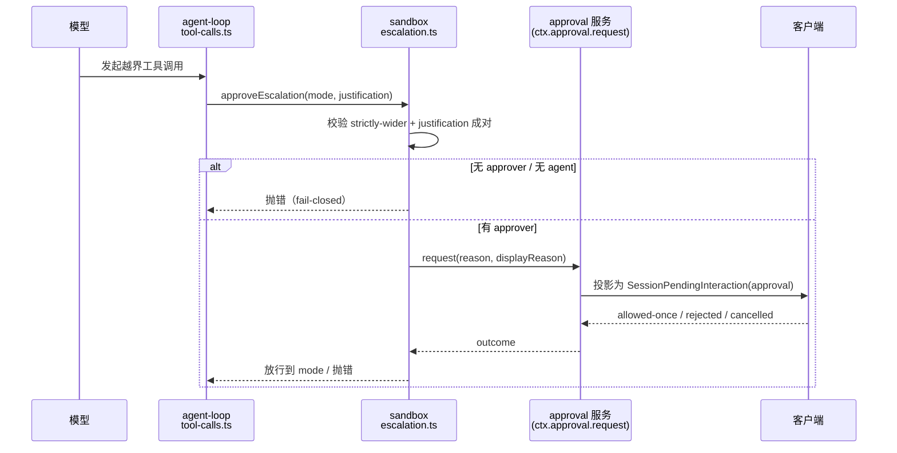

# DeepSeek Harness 仓库深读（第一步：地图 + 启动链）

> **方法**：`code-researcher` skill 的 `deep` 模式（四层法：Codebase Map → Runtime Story → Design Inquiry → Maintainer Notes），结论一律带 `文件:行`。
> **对象**：`github.com/deepseek-ai/deepseek-harness`，`master` = **`0.2.1-rc.2`**（本机安装的桌面版为 `0.2.0-rc.2`）。
> **快照**：2026-10-20，仓库 tarball 解包于 `/tmp/dsh-src`（`git clone` 在本机网络下会断流，改用 codeload）。
> **状态**：第一步（地图 + 启动链）与第二步（工具调用与审批链）已完成；`core/session` 事件模型与测试门槛待补。

---

## 1. Codebase Map：这个仓库是什么

一句话：**一个"一切皆插件"的 agent harness**，由 [Cordis](https://github.com/cordiverse/cordis) 驱动，设计论文指向 *A Programming Paradigm for Spatiotemporal Composability*（`README.zh.md:5`）。

### 1.1 规模（扫描实测）

| 指标 | 数值 |
|---|---|
| 文件数 | **16,180** |
| 总行数 | **2,680,168** |
| TypeScript | **1,243,960 行** |
| Markdown | 421,531 行 |
| CSS / JavaScript / Python | 32,190 / 18,321 / 15,547 行 |
| 包（`packages/`） | **约 50 个** |
| 应用（`apps/`） | **5 个**：`cli`、`desktop`、`desktop-host`、`web`、`plugin-market-generator` |

### 1.2 分层：包按职责归位（只列高信号的）

| 层 | 代表包 | 职责 | 读它的理由 |
|---|---|---|---|
| **启动/装载** | `boot/app-boot`、`boot/plugin-manager`、`boot/plugin-market`、`boot/cmdline`、`boot/hmr` | 加载 profile、组合 bundle、打 patch、启停插件 | 一切从这里的 Loader 开始 |
| **核心引擎** | `core/agent-loop`、`core/agent`、`core/session`、`core/tools`、`core/system-prompt`、`core/scope` | agent 轮次、会话事件、工具注册、系统提示 | 主运行路径所在 |
| **沙箱** | `sandbox/sandbox`、`sandbox/sandbox-policy` | 更宽模式阶梯、执行前 fail-closed 审批 | "授权 ≠ 审批"的底层 |
| **客户端/UI** | `client/ui-approval`、`client/ui-chat`、`client/*` | 浏览器侧渲染（含审批卡插槽） | 解释"卡只在会话内可见" |
| **API/网关** | `api/gateway`、`api/*` | 会话/事件对外暴露 | 远程事件与投影 |
| **组合包** | `bundle/base`、`bundle/sdk-minimal` | 预置组合（谁挂哪些插件） | 看"标准组合长什么样" |
| **外围** | `skill`、`mcp`、`schedule`、`workflow`、`computer-use`、`spill`、`ssh`、`document`、`browser-use` | 能力扩展 | 按需读 |

### 1.3 先读哪 10 个（阅读路线）

1. `README.zh.md`（定位与运行方式）
2. `apps/cli/src/bin.ts`（入口）
3. `apps/cli/src/profile-boot.ts`（`runProfile` 主链）
4. `packages/boot/app-boot/src/index.ts`（环境层/配置/补丁）
5. `packages/boot/plugin-manager/README.zh.md`（插件启停语义）
6. `packages/core/agent-loop/README.zh.md` → `src/index.ts`（轮次与工具调用）
7. `packages/core/session/README.zh.md`（事件与会话持久化）
8. `packages/sandbox/sandbox/src/escalation.ts`（审批与升级）
9. `packages/client/ui-approval/src/index.ts` + `src/client/contract/slots.ts`（审批卡插槽）
10. `packages/bundle/base/`（标准组合清单）

### 1.4 低信号区（别先读）

- `apps/web/tests/fixtures/**`（测试夹具，扫描把它误列为"入口"）
- `.agents/notes/archived/**`（历史 ADR；**但作为设计意图的一手证据很有价值**，按需精读）
- 生成物：`*.generated.ts`、`snapshots/**`、`website/**`（文档站）

---

## 2. Runtime Story #1：从命令到"运行中的应用"

**场景**：执行 `dsh`（或 `npx @deepseek-ai/dsh web`）时，仓库内部到底发生了什么。

| 步 | 位置 | 发生了什么 | 证据 |
|---|---|---|---|
| 1 | `apps/cli/src/bin.ts:1` | `#!/usr/bin/env node` 的 bin 入口 | package `bin` 指向 `lib/bin.js`（`apps/cli/package.json`）|
| 2 | `bin.ts:27` | `runCli()` 读取运行时版本、解析参数 | `getDshRuntimeVersion()`、`parseDshArgs(...)` |
| 3 | `bin.ts:36-38` | 按 `invocation.mode` 分派；`profile` 模式进入 `runProfile` | `const { runProfile } = await import('./profile-boot.ts')` |
| 4 | `profile-boot.ts:271` | `runProfile()`：装载环境 → 组合 profile → 启动 | `Promise<{ ctx: Context; shutdown: ProcessShutdown }>` |
| 5 | `profile-boot.ts:292` | **`composeProfile(...)`**：把 profile 与 bundle 组合成插件清单 | `const composed = await composeProfile(` |
| 6 | `profile-boot.ts:323` | **`boot(NAME, rootConfig, patches, ...)`**：交给 Loader 启动 | `const ctx = await boot(NAME, rootConfig, ...)` |
| 7 | `profile-boot.ts:329` | 挂载**插件包管理器** | `await hostCtx.plugin(PluginPackages, {...})` |
| 8 | `app-boot/src/index.ts:238` | `loadLayeredEnv()`：分层环境变量（系统/用户/profile） | 三层合并 |
| 9 | `app-boot/src/index.ts:307` | `recomposeProfile()`：配置变更后**重新组合**（HMR 基础） | — |
| 10 | `app-boot/src/index.ts:322` | `reconcileProfilePatches()`：把 patch 对账到当前 profile | — |

**能读出的三条事实**
1. **启动是"组合"而非"实例化"**：`composeProfile` 先算出插件清单，再交给通用 Loader `boot()`；没有硬编码的应用装配代码。
2. **环境也是分层的**：`loadLayeredEnv` 与 profile patch 对账分离，说明"配置来源"与"配置生效"被刻意拆开。
3. **插件管理是运行期能力**：`hostCtx.plugin(PluginPackages, ...)` 在 boot 回调里挂载，所以 Web 侧边栏能启停插件而不重启进程（`plugin-manager/README.zh.md` 也这么说）。

---

## 3. Design Inquiry（初探）：为什么要"一切皆插件"

**观察（代码事实）**
- 启动路径上没有"应用主类"，只有 `composeProfile → boot`（`profile-boot.ts:292,323`）。
- 组合包（`bundle/base`、`bundle/sdk-minimal`）只是**配置清单**，`agent-loop` 的 README 明确写"标准 agent 组合应挂载本包"（`packages/core/agent-loop/README.zh.md:11`）。
- 插件管理在运行期可用（`plugin-manager/README.zh.md`），且 HMR 只在 YAML 开时生效。

**推断（研究判断，非代码事实）**
1. **插件化的收益是"能力可替换 + 启动可裁剪"**：同一条 `boot` 路径既能起 Web、也能起 CLI、也能起 Desktop，差别只在 profile 组合。
2. **代价是"间接层变厚"**：读代码时，"这个功能在哪"要靠组合清单反查，而组合清单本身是配置（YAML），不是 import 图。
3. **Cordis 的"时空可组合"**（论文标题）在本仓库最直接的体现就是：**同一套插件在有/无某能力的会话里表现不同**（session/scope 语义），这也是"scope"包存在的理由。

> **待验证**：`core/scope` 的语义边界、以及"插件之间不允许直接 import"的约束是否被 lint 强制——留给第二步。

---

## 4. Maintainer Notes（初版）

| 关注点 | 现状（证据） | 影响 |
|---|---|---|
| **扩展点** | 新增能力 = 新增包 + 在 bundle/profile 里挂载 | 不需要改核心；但**必须同时改组合清单**，否则不会生效 |
| **兼容性** | README 明示"开发者预览，会有破坏性变更"（`README.zh.md:13`） | 依赖它的外部项目要锁版本 |
| **配置分层** | 环境层 + profile + patch（`app-boot`） | 排障时先看"哪一层覆盖了谁"，别直接改代码 |
| **审批与沙箱** | `sandbox/escalation` 执行前 fail-closed | 想加"免审批"要走策略层，不要在工具里绕 |
| **测试门槛** | 包内 `tests/` 密度高（如 `agent-loop/tests/` 10+ 个 spec） | 改动前先跑对应包的 spec |

---

## 4.5 Runtime Story #2：一次工具调用与审批（代码事实）

**场景**：模型发起一次越界工具调用（例如写授权区外路径），系统如何"先问人、再执行"。

| 步 | 位置 | 发生了什么 | 证据 |
|---|---|---|---|
| 1 | `core/agent-loop/src/tool-calls.ts:60` | `executeToolCalls()` 统一驱动本轮的多个工具调用 | 导出签名 |
| 2 | `tool-calls.ts:211,216` | 执行前可 await（有序 pre-execute）；只有 dispatch/body 允许重叠 | 注释即契约 |
| 3 | `sandbox/sandbox/src/escalation.ts:11-13` | 工具层**闭包** `ctx.approval.request(...)` 并下传，沙箱包**不依赖** approval 服务类型 | 模块注释 |
| 4 | `escalation.ts:28` | `WIDER_MODES`：`workspace-write → danger-full-access`（严格更宽阶梯） | 常量表 |
| 5 | `escalation.ts:41` | `ESCALATION_TARGETS`：**封闭**的升级目标词表 | 常量 |
| 6 | `escalation.ts:51` | `validateEscalationArgs()`：`sandbox_permissions` 与 `justification` **必须成对**，缺一即"畸形请求" | 函数 |
| 7 | `escalation.ts:approveEscalation` | 先校验"严格更宽"；再校验**有 approver**、**有 agent 可路由**；然后才 `approver.request(...)` | 逐行可见 |
| 8 | 同上 | `request` 传 `{agent, toolName, callId, reason: "escalate sandbox to ...", displayReason{en,zh}}` | 同一处 |
| 9 | 同上 | 结果闭集：`allowed-once` / `rejected` / `cancelled` / **`unavailable`** | `switch` 四个分支 |
| 10 | 同上 | **`unavailable` 直接抛错**："requires approval, but no approval channel is available" | 错误文本 |

**三个可以直接下结论的代码事实**

1. **审批是"执行前"的硬门**：`approveEscalation` 在任何执行之前完成校验与询问，且 `rejected` 会抛硬错并提示"不要绕过"（错误文本原文如此）。**设计上是 fail-closed**。
2. **没有 approver 就不执行**：`approval.approver === undefined` 或 `approval.agent === undefined` 都**立刻抛错**，而不是静默放行。**这推翻了"没通道就一直挂"的猜想——开源层遇到无通道是报错，不是等。**
3. **审批是"会话级待处理交互"**：客户端把审批放进 `SessionPendingInteractionMap`（`packages/client/ui-session/src/client/index.ts:51`，由 `ui-approval` 声明 `approval: PendingApproval`，`ui-approval/src/client/contract/slots.ts:21-27`），而详情插槽 `conversation.approval.detail` 的作用域写明 `scope: 'session'`（`slots.ts:36-39`）。**所以"卡只在会话里"是类型系统层面的设计，不是渲染 bug。**

### 4.5.1 这对我们那两起事故意味着什么

| 我们的现象 | 代码能解释的部分 | 代码不能解释的部分（推断） |
|---|---|---|
| 审批卡只在 Bot 私聊里可见 | **能**：审批是 session 级 pending interaction（`ui-session/src/client/index.ts:51`、`slots.ts:36-39`）| 为什么没有"跨会话/全局"的入口——**开源层就没有这个 surface** |
| 没有审批请求被创建（`approval/asked` = 0）| **能**：没有越界调用就不会有请求 | — |
| 会话卡在 `working` 十小时 | **部分**：开源层"无通道"是**抛错**，不是等待 | **挂起发生在闭源的 Host/Bot 层**：approver 存在但永不 settle（无人可答），或唤醒被抑制 |

> **口径**：前两行是代码事实；第三行只能给"闭源层"的推断，**必须与代码事实分开写**——这也是我们给自己定的引用纪律。

---

## 5. 下一步（第二步要交付的）

1. **Runtime Story #2：一次工具调用与审批** —— `core/agent-loop/src/tool-calls.ts` → `sandbox/sandbox/src/escalation.ts` → `client/ui-approval/src/client/contract/slots.ts`，把"卡为什么只在会话内可见"讲成代码事实。
2. **设计追问**：`core/session` 的事件模型（谁投影到客户端、谁写盘）。
3. **证据索引 + claim audit**：汇总所有结论↔`文件:行`，对强结论跑 `claim_audit.py`。

---

## 5.5 证据索引补充（第二步）

| 结论 | 证据 |
|---|---|
| 工具调用统一入口 | `packages/core/agent-loop/src/tool-calls.ts:60` |
| 执行前可 await、dispatch/body 才重叠 | `tool-calls.ts:211,216` |
| 审批由工具层闭包下传，沙箱不依赖 approval 类型 | `packages/sandbox/sandbox/src/escalation.ts:11-13` |
| 严格更宽阶梯 | `escalation.ts:28`（`WIDER_MODES`）|
| 升级目标为封闭词表 | `escalation.ts:41`（`ESCALATION_TARGETS`）|
| `sandbox_permissions` 与 `justification` 必须成对 | `escalation.ts:51`（`validateEscalationArgs`）|
| 无 approver / 无 agent 即抛错（fail-closed）| `escalation.ts:approveEscalation` 前半段 |
| 审批结果闭集（allowed-once / rejected / cancelled / unavailable）| 同上 `switch` |
| 无通道 = 抛 `unavailable`，不是挂起 | 同上错误文本 |
| 审批是会话级待处理交互 | `packages/client/ui-session/src/client/index.ts:51`、`ui-approval/src/client/contract/slots.ts:21-27` |
| 审批详情插槽作用域 = session | `slots.ts:36-39`（`scope: 'session'`）|

## 5.7 第三步：会话事件模型与组合包（代码事实）

### 5.7.1 会话是"仅追加的事件日志"

`packages/core/session/README.zh.md` 的定位（原文摘要，`kind: package-reference`）：
> 在**仅追加**的会话日志中记录每个模型可见事实，并**从该记录派生模型历史**；消费方可检查、回放、fork、刷新会话，同时保留历史事件；**压缩（compaction）只在活跃对话中隐藏被取代的条目，不删除**；除非加持久化后端，否则会话仅驻留内存。

**事件词表是封闭的**（`packages/core/session/src/known-event-types.ts`，90 行），与本主题直接相关的三条：

| 事件 | 位置 | 含义 |
|---|---|---|
| `approval/asked` | `known-event-types.ts:25` | 审批被请求 |
| `approval/decided` | `:26` | 审批有结论 |
| `approval/policy` | `:27` | 策略级（非单次）决定 |

同文件还有 `assistant/attempt`、`assistant/message`、`compaction/{start,prune,summary,end}`、`goal/change`、`hook/{invoked,result}` 等。

> **这解释了为什么"审批"在我们的观测里既是"会话内 UI"又是"日志事件"**：它同时是 **session 级待处理交互**（`ui-session` 的 `SessionPendingInteractionMap`）和 **session 日志里的一条事件**（`approval/asked`）。两者都不是"跨会话广播"——**没有全局审批总线**。

### 5.7.2 组合包：`base` 是"共享核心 + 分层 patch"，`sdk-minimal` 是"独立整树"

两份清单分别是 `packages/bundle/base/cordis.patch.yml`（529 行）与 `packages/bundle/sdk-minimal/cordis.patch.yml`（172 行）；下表的行数与结构均取自这两个文件及其首段注释。

| 组合包 | 清单行数 | 结构 | 关键注释（原文） |
|---|---|---|---|
| `packages/bundle/base` | **529 行** `cordis.patch.yml` | **一个 insert 覆盖空 profile root**，作为共享核心；后续 bundle 与用户 patch 按 `id` 覆盖，**逐行 last write wins** | "applied as ONE insert over the empty profile root"；"the last write wins per row" |
| `packages/bundle/sdk-minimal` | **172 行** `cordis.patch.yml` | **不叠在 base 之上**，自身就是完整的 Cordis 树 | "does not layer over dsh-base: this insert is the complete Cordis tree" |

**两条设计事实（都可引用行号）**
1. **patch 是"替换整行 config"而不是深合并**：`base/cordis.patch.yml:7-9` 明写 "A patch replaces the targeted row's whole `config` rather than merging into it"，所以"按模式取值不同"的配置**不在 base 里**，而由各模式 bundle 完整重述。
2. **行的顺序不承载加载语义**：`base/cordis.patch.yml:13` 写 "Row order carries no load semantics (activation is service-availability driven)"——**激活由服务可用性驱动**，不是按 YAML 顺序启动。

> **维护含义**：想"改一个插件的行为"，正确做法是**改它所在模式 bundle 的那一行**（整行 config 替换）；想"加一个能力"，要**同时**更新组合清单与用户 profile，否则 profile 层根本看不到它。

## 5.6 待补（第三步）

- `core/session` 的事件模型：谁产生事件、谁投影到客户端、谁落盘；
- 测试门槛：`agent-loop/tests/*.spec.ts` 覆盖的契约（如 `inbox.spec.ts` 对应"轮次内排队"）；
- `core/tools` 的工具注册与 `tool-calls.ts` 的调度关系（并行调用上限 `maxParallelToolCalls` 的落点）；
- 压缩（compaction）与"派生历史"的边界：哪些事件会改变模型可见历史。

## 5.8 证据索引补充（第三步）

| 结论 | 证据 |
|---|---|
| 会话是仅追加日志、历史由事件派生 | `packages/core/session/README.zh.md` 概述段 |
| 压缩隐藏不删除 | 同上（"hide superseded entries…does not delete"）|
| 事件词表封闭且含审批三类事件 | `packages/core/session/src/known-event-types.ts:25-27`（`approval/asked`、`approval/decided`、`approval/policy`）|
| base 是"共享核心 + 逐行 last write wins" | `packages/bundle/base/cordis.patch.yml:1-4` |
| patch 替换整行 config、不深合并 | `packages/bundle/base/cordis.patch.yml:7-9` |
| 行顺序不承载加载语义、激活由服务可用性驱动 | `packages/bundle/base/cordis.patch.yml:13` |
| sdk-minimal 不叠 base、自身是完整树 | `packages/bundle/sdk-minimal/cordis.patch.yml:1-3` |

## 6. 证据索引（本文）

| 结论 | 证据 |
|---|---|
| 仓库版本 0.2.1-rc.2 | `package.json`（`@deepseek-ai/dsh-root`）|
| 一切皆插件、Cordis 驱动 | `README.zh.md:5` |
| 开发者预览、会有破坏性变更 | `README.zh.md:13` |
| 入口为 `bin.ts` 的 `runCli()` | `apps/cli/src/bin.ts:1,27` |
| profile 模式进 `runProfile` | `apps/cli/src/bin.ts:36-38`、`apps/cli/src/profile-boot.ts:271` |
| 组合 → boot → 插件管理 | `profile-boot.ts:292,323,329` |
| 环境分层 / 重组 / patch 对账 | `app-boot/src/index.ts:238,307,322` |
| agent-loop 是"标准组合应挂载"的驱动器 | `packages/core/agent-loop/README.zh.md:11` |
