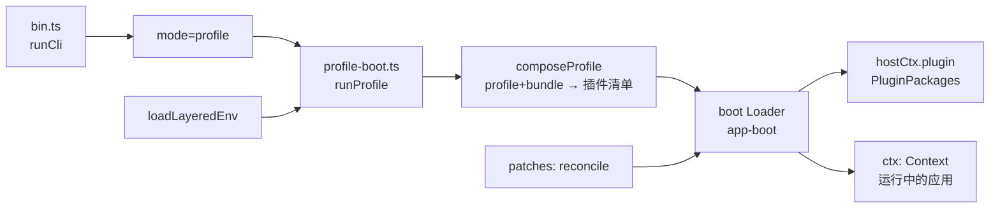

# DeepSeek Harness 仓库深读（第一步：地图 + 启动链）

> **方法**：`code-researcher` skill 的 `deep` 模式（四层法：Codebase Map → Runtime Story → Design Inquiry → Maintainer Notes），结论一律带 `文件:行`。
> **对象**：`github.com/deepseek-ai/deepseek-harness`，`master` = **`0.2.1-rc.2`**（本机安装的桌面版为 `0.2.0-rc.2`）。
> **快照**：2026-10-20，仓库 tarball 解包于 `/tmp/dsh-src`（`git clone` 在本机网络下会断流，改用 codeload）。
> **状态**：本文是**第一步**（地图 + 第一条运行路径）；第二条运行路径（工具调用与审批）与设计取舍、维护笔记在后续补充。

---

## 1. Codebase Map：这个仓库是什么

一句话：**一个"一切皆插件"的 agent harness**，由 [Cordis](https://github.com/cordiverse/cordis) 驱动，设计论文指向 *A Programming Paradigm for Spatiotemporal Composability*（`README.zh.md:5`）。

### 1.1 规模（扫描实测）

| 指标 | 数值 |
|---|---|
| 文件数 | **16,180** |
| 总行数 | **2,680,168** |
| TypeScript | **1,243,960 行** |
| Markdown | 421,531 行 |
| CSS / JavaScript / Python | 32,190 / 18,321 / 15,547 行 |
| 包（`packages/`） | **约 50 个** |
| 应用（`apps/`） | **5 个**：`cli`、`desktop`、`desktop-host`、`web`、`plugin-market-generator` |

### 1.2 分层：包按职责归位（只列高信号的）

| 层 | 代表包 | 职责 | 读它的理由 |
|---|---|---|---|
| **启动/装载** | `boot/app-boot`、`boot/plugin-manager`、`boot/plugin-market`、`boot/cmdline`、`boot/hmr` | 加载 profile、组合 bundle、打 patch、启停插件 | 一切从这里的 Loader 开始 |
| **核心引擎** | `core/agent-loop`、`core/agent`、`core/session`、`core/tools`、`core/system-prompt`、`core/scope` | agent 轮次、会话事件、工具注册、系统提示 | 主运行路径所在 |
| **沙箱** | `sandbox/sandbox`、`sandbox/sandbox-policy` | 更宽模式阶梯、执行前 fail-closed 审批 | "授权 ≠ 审批"的底层 |
| **客户端/UI** | `client/ui-approval`、`client/ui-chat`、`client/*` | 浏览器侧渲染（含审批卡插槽） | 解释"卡只在会话内可见" |
| **API/网关** | `api/gateway`、`api/*` | 会话/事件对外暴露 | 远程事件与投影 |
| **组合包** | `bundle/base`、`bundle/sdk-minimal` | 预置组合（谁挂哪些插件） | 看"标准组合长什么样" |
| **外围** | `skill`、`mcp`、`schedule`、`workflow`、`computer-use`、`spill`、`ssh`、`document`、`browser-use` | 能力扩展 | 按需读 |

### 1.3 先读哪 10 个（阅读路线）

1. `README.zh.md`（定位与运行方式）
2. `apps/cli/src/bin.ts`（入口）
3. `apps/cli/src/profile-boot.ts`（`runProfile` 主链）
4. `packages/boot/app-boot/src/index.ts`（环境层/配置/补丁）
5. `packages/boot/plugin-manager/README.zh.md`（插件启停语义）
6. `packages/core/agent-loop/README.zh.md` → `src/index.ts`（轮次与工具调用）
7. `packages/core/session/README.zh.md`（事件与会话持久化）
8. `packages/sandbox/sandbox/src/escalation.ts`（审批与升级）
9. `packages/client/ui-approval/src/index.ts` + `src/client/contract/slots.ts`（审批卡插槽）
10. `packages/bundle/base/`（标准组合清单）

### 1.4 低信号区（别先读）

- `apps/web/tests/fixtures/**`（测试夹具，扫描把它误列为"入口"）
- `.agents/notes/archived/**`（历史 ADR；**但作为设计意图的一手证据很有价值**，按需精读）
- 生成物：`*.generated.ts`、`snapshots/**`、`website/**`（文档站）

---

## 2. Runtime Story #1：从命令到"运行中的应用"

**场景**：执行 `dsh`（或 `npx @deepseek-ai/dsh web`）时，仓库内部到底发生了什么。

| 步 | 位置 | 发生了什么 | 证据 |
|---|---|---|---|
| 1 | `apps/cli/src/bin.ts:1` | `#!/usr/bin/env node` 的 bin 入口 | package `bin` 指向 `lib/bin.js`（`apps/cli/package.json`）|
| 2 | `bin.ts:27` | `runCli()` 读取运行时版本、解析参数 | `getDshRuntimeVersion()`、`parseDshArgs(...)` |
| 3 | `bin.ts:36-38` | 按 `invocation.mode` 分派；`profile` 模式进入 `runProfile` | `const { runProfile } = await import('./profile-boot.ts')` |
| 4 | `profile-boot.ts:271` | `runProfile()`：装载环境 → 组合 profile → 启动 | `Promise<{ ctx: Context; shutdown: ProcessShutdown }>` |
| 5 | `profile-boot.ts:292` | **`composeProfile(...)`**：把 profile 与 bundle 组合成插件清单 | `const composed = await composeProfile(` |
| 6 | `profile-boot.ts:323` | **`boot(NAME, rootConfig, patches, ...)`**：交给 Loader 启动 | `const ctx = await boot(NAME, rootConfig, ...)` |
| 7 | `profile-boot.ts:329` | 挂载**插件包管理器** | `await hostCtx.plugin(PluginPackages, {...})` |
| 8 | `app-boot/src/index.ts:238` | `loadLayeredEnv()`：分层环境变量（系统/用户/profile） | 三层合并 |
| 9 | `app-boot/src/index.ts:307` | `recomposeProfile()`：配置变更后**重新组合**（HMR 基础） | — |
| 10 | `app-boot/src/index.ts:322` | `reconcileProfilePatches()`：把 patch 对账到当前 profile | — |

**能读出的三条事实**
1. **启动是"组合"而非"实例化"**：`composeProfile` 先算出插件清单，再交给通用 Loader `boot()`；没有硬编码的应用装配代码。
2. **环境也是分层的**：`loadLayeredEnv` 与 profile patch 对账分离，说明"配置来源"与"配置生效"被刻意拆开。
3. **插件管理是运行期能力**：`hostCtx.plugin(PluginPackages, ...)` 在 boot 回调里挂载，所以 Web 侧边栏能启停插件而不重启进程（`plugin-manager/README.zh.md` 也这么说）。

---

## 3. Design Inquiry（初探）：为什么要"一切皆插件"

**观察（代码事实）**
- 启动路径上没有"应用主类"，只有 `composeProfile → boot`（`profile-boot.ts:292,323`）。
- 组合包（`bundle/base`、`bundle/sdk-minimal`）只是**配置清单**，`agent-loop` 的 README 明确写"标准 agent 组合应挂载本包"（`packages/core/agent-loop/README.zh.md:11`）。
- 插件管理在运行期可用（`plugin-manager/README.zh.md`），且 HMR 只在 YAML 开时生效。

**推断（研究判断，非代码事实）**
1. **插件化的收益是"能力可替换 + 启动可裁剪"**：同一条 `boot` 路径既能起 Web、也能起 CLI、也能起 Desktop，差别只在 profile 组合。
2. **代价是"间接层变厚"**：读代码时，"这个功能在哪"要靠组合清单反查，而组合清单本身是配置（YAML），不是 import 图。
3. **Cordis 的"时空可组合"**（论文标题）在本仓库最直接的体现就是：**同一套插件在有/无某能力的会话里表现不同**（session/scope 语义），这也是"scope"包存在的理由。

> **待验证**：`core/scope` 的语义边界、以及"插件之间不允许直接 import"的约束是否被 lint 强制——留给第二步。

---

## 4. Maintainer Notes（初版）

| 关注点 | 现状（证据） | 影响 |
|---|---|---|
| **扩展点** | 新增能力 = 新增包 + 在 bundle/profile 里挂载 | 不需要改核心；但**必须同时改组合清单**，否则不会生效 |
| **兼容性** | README 明示"开发者预览，会有破坏性变更"（`README.zh.md:13`） | 依赖它的外部项目要锁版本 |
| **配置分层** | 环境层 + profile + patch（`app-boot`） | 排障时先看"哪一层覆盖了谁"，别直接改代码 |
| **审批与沙箱** | `sandbox/escalation` 执行前 fail-closed | 想加"免审批"要走策略层，不要在工具里绕 |
| **测试门槛** | 包内 `tests/` 密度高（如 `agent-loop/tests/` 10+ 个 spec） | 改动前先跑对应包的 spec |

---

## 5. 下一步（第二步要交付的）

1. **Runtime Story #2：一次工具调用与审批** —— `core/agent-loop/src/tool-calls.ts` → `sandbox/sandbox/src/escalation.ts` → `client/ui-approval/src/client/contract/slots.ts`，把"卡为什么只在会话内可见"讲成代码事实。
2. **设计追问**：`core/session` 的事件模型（谁投影到客户端、谁写盘）。
3. **证据索引 + claim audit**：汇总所有结论↔`文件:行`，对强结论跑 `claim_audit.py`。

---

## 6. 证据索引（本文）

| 结论 | 证据 |
|---|---|
| 仓库版本 0.2.1-rc.2 | `package.json`（`@deepseek-ai/dsh-root`）|
| 一切皆插件、Cordis 驱动 | `README.zh.md:5` |
| 开发者预览、会有破坏性变更 | `README.zh.md:13` |
| 入口为 `bin.ts` 的 `runCli()` | `apps/cli/src/bin.ts:1,27` |
| profile 模式进 `runProfile` | `apps/cli/src/bin.ts:36-38`、`apps/cli/src/profile-boot.ts:271` |
| 组合 → boot → 插件管理 | `profile-boot.ts:292,323,329` |
| 环境分层 / 重组 / patch 对账 | `app-boot/src/index.ts:238,307,322` |
| agent-loop 是"标准组合应挂载"的驱动器 | `packages/core/agent-loop/README.zh.md:11` |
